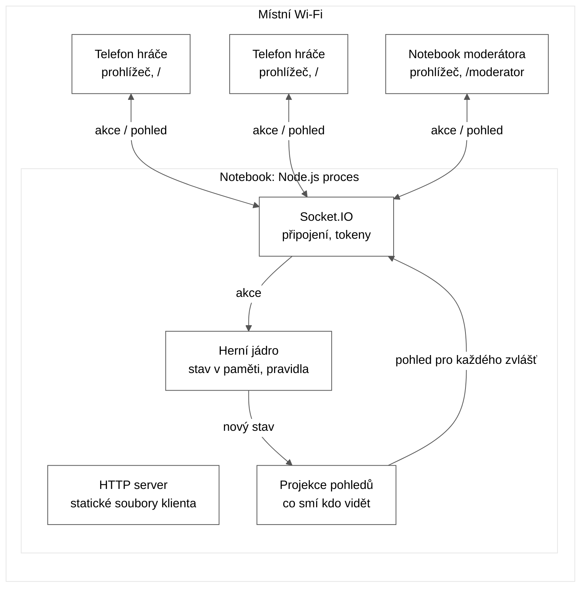
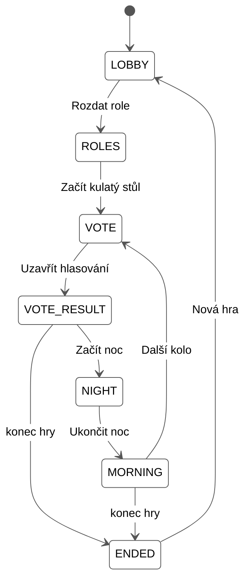

# Zrada – technické řešení a plán vývoje

16. 11. 2026 · vychází z [SPEC.md](SPEC.md), [zradci-analyza.md](zradci-analyza.md) a [zradci-design.md](zradci-design.md)

## Shrnutí

Pro první verzi doporučuju **jednu Node.js aplikaci v TypeScriptu**. Server drží hru v paměti a přes WebSocket (Socket.IO) posílá každému telefonu jen jeho vlastní pohled na hru. Klient je React aplikace postavená ve Vite, kterou server sám servíruje. Celá hra se spouští jedním příkazem na notebooku moderátora a telefony se připojí přes Wi-Fi na jeho IP adresu.

Hlavní rozhodnutí:

- **Žádná databáze.** SPEC nevyžaduje, aby hra přežila restart, a stačí jedna hra najednou. Stav je jeden objekt v paměti serveru.
- **Herní pravidla jako čisté funkce.** Celá logika hry je oddělená od sítě i obrazovek, takže jde otestovat bez telefonů.
- **Utajení řeší server výpočtem pohledu.** Po každé změně server spočítá pro každého hráče zvlášť, co smí vidět, a pošle mu jen to. Role ostatních se do telefonu vůbec nedostanou.
- **Jeden jazyk od serveru po telefon.** TypeScript všude, sdílené typy zpráv mezi serverem a klientem.

Odhad: 5–6 hodin práce s Claude Code, tedy jedno delší odpoledne.

## Vstupy a omezení

Z dokumentů ve složce DOC plynou pro architekturu tyto požadavky:

| Požadavek | Zdroj | Dopad na architekturu |
| --- | --- | --- |
| Jen lokální síť, žádné nasazení, internet není potřeba | SPEC, zadání kurzu | Jeden proces na notebooku, nic z internetu (ani fonty z CDN) |
| 4–18 hráčů, jedna hra najednou | SPEC | Stav v paměti, žádné škálování |
| Hra nemusí přežít restart | SPEC | Bez databáze |
| Všechny telefony se přepnou najednou | analýza, SPEC | Server posílá změny sám (push), ne dotazování |
| Telefon nesmí dostat cizí role, ani skrytě | analýza, SPEC | Každý klient dostává jen svůj pohled, počítaný na serveru |
| Návrat do hry po zavření prohlížeče | SPEC, bod 5 v „Hotovo, když“ | Trvalý token hráče v prohlížeči |
| Bez instalace, přes QR kód | SPEC | Webová stránka v mobilním prohlížeči |
| Hotovo za jedno odpoledne | zadání kurzu | Co nejméně vrstev a nástrojů |

## Proč ne Spring Boot a PostgreSQL z analýzy

Analýza navrhuje stejný stack jako Storyhold (Spring Boot, React, PostgreSQL, nginx), protože počítala s produkčním provozem na VPS. Pro lokální demo za odpoledne je to zbytečně těžké:

- Dva jazyky (Java a TypeScript) znamenají dvakrát definované zprávy a dva buildy.
- PostgreSQL by se musela instalovat a spouštět jen kvůli stavu, který nemusí přežít restart.
- STOMP přes Spring je pro 10 klientů víc konfigurace než užitku.

Node.js 22 a npm 11 už na notebooku jsou. Kdyby se hra později nasazovala jako služba pro zákazníky, herní jádro (čisté funkce) jde přepsat do Javy 1 : 1 a návrh z analýzy pak dává smysl.

## Architektura



Tok jedné akce:

1. Telefon pošle **úmysl**, např. `vote { targetId }`. Nikdy neposílá výsledek ani stav.
2. Server ověří, kdo akci posílá (podle tokenu), a předá ji hernímu jádru.
3. Jádro zkontroluje, zda akce v dané fázi a pro daného hráče platí. Neplatnou akci zahodí a vrátí chybu jen odesílateli.
4. Jádro vrátí nový stav hry.
5. Projekce spočítá pro každého připojeného hráče a pro moderátora jeho pohled a server ho pošle zprávou `view`.
6. Klient pohled jen vykreslí. Žádná herní logika v klientovi není.

Pro 10 hráčů je posílání celého pohledu po každé změně zanedbatelná zátěž (jednotky kB). Odpadá tak celá kategorie chyb s rozjetým stavem mezi telefony.

## Technologie

| Vrstva | Volba | Proč |
| --- | --- | --- |
| Jazyk | **TypeScript** (server i klient) | Jeden jazyk, sdílené typy zpráv, chyby odhalí kompilátor |
| Běhové prostředí | **Node.js 22** | Už je nainstalovaný, rychlý start |
| Server | **Express** + **Socket.IO 4** | Express servíruje klienta, Socket.IO řeší WebSocket včetně automatického znovupřipojení |
| Klient | **React 18** + **Vite** | Rychlý vývoj s okamžitým obnovením stránky, jednoduchý build |
| Směrování v klientovi | žádná knihovna; dvě cesty `/` a `/moderator` se rozliší podle adresy | Dvě obrazovky routing knihovnu nepotřebují |
| Styly | **CSS proměnné** a obyčejné CSS moduly | Barvy z návrhu designu jako tokeny, bez dalšího nástroje |
| Písma | **@fontsource/cinzel**, **@fontsource/figtree** | Fonty přibalené v aplikaci, fungují bez internetu; obě s plnou češtinou |
| QR kód | **qrcode.react** | Vykreslí QR v prohlížeči moderátora |
| Testy | **Vitest** | Stejná konfigurace jako Vite, rychlé testy herního jádra |
| Spouštění vývoje | **tsx** + `node --watch`, Vite jako middleware v Expressu | Jeden příkaz `npm run dev`, jeden port pro stránku, Socket.IO i obnovování stránky při změnách |

Záměrně nepoužíváme: databázi, přihlašování, správu stavu typu Redux (pohled ze serveru je jediný stav klienta), UI knihovnu komponent ani animační knihovnu (karta s pečetí zvládne CSS transition).

## Struktura projektu

```
zrada/
├─ package.json            jeden balíček, skripty dev / build / start / test
├─ shared/
│  └─ types.ts             typy: Phase, Role, akce klienta, pohledy (PlayerView, ModeratorView)
├─ server/
│  ├─ index.ts             Express + Socket.IO, LAN IP, výpis odkazů do konzole
│  ├─ game/
│  │  ├─ engine.ts         stav hry a funkce apply(state, action) → nový stav
│  │  ├─ rules.ts          rozdání rolí, vyhodnocení hlasování a noci, konec hry
│  │  ├─ views.ts          viewForPlayer(state, id), viewForModerator(state)
│  │  └─ random.ts         zdroj náhody, v testech nahraditelný
│  └─ game/__tests__/      testy pravidel a simulace celé hry s boty
└─ client/
   ├─ index.html
   ├─ main.tsx             rozhodne podle adresy: hráč, nebo moderátor
   ├─ socket.ts            připojení, token, příjem pohledu
   ├─ theme.css            barvy a písma z návrhu designu
   ├─ player/              obrazovky telefonu (Vstup, Čekárna, Role, Hlasování, Noc, …)
   ├─ moderator/           Lobby, Řízení hry, Konec
   └─ components/          tlačítko, mřížka hráčů, karta s pečetí, fázový štítek
```

## Herní jádro

### Stav hry

```ts
type Phase = 'LOBBY' | 'ROLES' | 'VOTE' | 'VOTE_RESULT' | 'NIGHT' | 'MORNING' | 'ENDED';
type Role = 'LOYAL' | 'TRAITOR';
type Status = 'ALIVE' | 'BANISHED' | 'MURDERED';

interface Player {
  id: string;            // veřejné id pro hlasování
  token: string;         // tajný token, zná ho jen jeho telefon
  name: string;
  role?: Role;           // přidělena při rozdání rolí
  status: Status;
  sawRole: boolean;
  connected: boolean;
}

interface GameState {
  phase: Phase;
  round: number;
  traitorCount: number;
  players: Player[];
  votes: Record<string, string>;       // voterId → targetId, platí pro aktuální fázi
  nightPicks: Record<string, string>;  // traitorId → targetId
  nightTips: Record<string, string>;   // tipy Věrných, nikam se nepočítají
  history: RoundResult[];              // kdo byl v kterém kole vyhnán a kdo zemřel
  winner?: 'LOYAL' | 'TRAITOR';
}
```

### Fáze a přechody



Kontrola konce hry proběhne automaticky při přechodu do `VOTE_RESULT` a do `MORNING`. Když hra skončila, moderátor místo tlačítka „Začít noc“ / „Další kolo“ uvidí rovnou výsledek (fáze `ENDED`).

### Akce

| Akce | Kdo | Ve fázi | Co udělá |
| --- | --- | --- | --- |
| `join { name }` | nový hráč | LOBBY | Přidá hráče, vrátí token. Odmítne prázdné nebo duplicitní jméno. |
| `kick { playerId }` | moderátor | LOBBY | Odebere hráče |
| `startGame { traitorCount }` | moderátor | LOBBY, min. 4 hráči | Náhodně rozdá role, fáze ROLES |
| `ackRole` | hráč | ROLES a dál | `sawRole = true` |
| `startVote` | moderátor | ROLES, MORNING | Vynuluje hlasy, fáze VOTE |
| `vote { targetId }` | živý hráč | VOTE | Uloží nebo přepíše hlas. Nesmí hlasovat pro sebe ani pro mrtvého. |
| `closeVote` | moderátor | VOTE | Vyhodnotí hlasy, fáze VOTE_RESULT, nebo ENDED |
| `startNight` | moderátor | VOTE_RESULT | Fáze NIGHT |
| `nightPick { targetId }` | živý hráč | NIGHT | Zrádce: volba oběti, nesmí být Zrádce. Věrný: tip. Obojí přes stejnou zprávu. |
| `endNight` | moderátor | NIGHT | Vyhodnotí noc, fáze MORNING, nebo ENDED |
| `newGame` | moderátor | ENDED | Hráči zůstanou připojení, role a stav se vynulují, fáze LOBBY |

`nightPick` je jedna zpráva pro obě role. Kdyby Zrádci posílali jinou zprávu než Věrní, šlo by role rozlišit i z provozu v síti.

### Pravidla vyhodnocení (podle SPEC)

- **Hlasování:** sečíst hlasy živých hráčů. Nejvíc hlasů = vyhnán. Remíza = los mezi remízujícími. Žádný hlas = nikdo není vyhnán.
- **Noc:** volby živých Zrádců. Jedna volba nebo shoda = ta oběť. Různé volby = los mezi nimi. Žádná volba = los mezi živými Věrnými.
- **Konec hry:** 0 živých Zrádců = vyhrávají Věrní. Živých Zrádců ≥ živých Věrných = vyhrávají Zrádci.
- **Počet Zrádců:** výchozí 1 při 4–7 hráčích, 2 při 8–10. Moderátor může změnit, ale musí platit: Zrádců je méně než Věrných.

Všechna náhoda jde přes `random.ts`, aby testy mohly dosadit předvídatelný los.

## Pohledy a utajení

Tohle je bezpečnostní jádro aplikace. Klient nikdy nedostane `GameState`, jen výsledek jedné z těchto funkcí.

**`viewForPlayer(state, playerId)` obsahuje:**

- fázi, kolo, vlastní jméno, vlastní stav a **vlastní roli**,
- jména spoluzrádců, ale jen pokud je hráč Zrádce,
- seznam hráčů jen s `id`, `name` a veřejným stavem (živý / vyhnán / zemřel). **Bez rolí.**
- role vyhnaných hráčů (ty jsou veřejné), a na konci hry role všech,
- vlastní hlas nebo vlastní noční volbu,
- v noci řádek pod mřížkou: Zrádce ve dvojici dostane volbu spojence, všichni ostatní svou vlastní volbu. Pole se v obou případech jmenuje stejně (`nightHint`) a má stejný tvar.
- v noci **stejnou mřížku pro všechny**: všichni živí kromě sebe. Pro Zrádce jsou spoluzrádci v pohledu označeni jako nevybratelní; u Věrného je stejné pole vždy `false`. Obrazovky pak vypadají stejně a liší se jen tím, co klepnutí udělá.

**`viewForModerator(state)` obsahuje** všechno včetně rolí, stav připojení, kdo hlasoval, a v noci jen „Zrádci hotovo / čeká se“. Konkrétní volbu Zrádců moderátor nedostane (podle SPEC ji zjistí až ráno).

**Ochrany navíc:**

- Moderátorská stránka je chráněná tajným klíčem. Server ho při startu vygeneruje a vypíše do konzole odkaz `http://<IP>:<port>/moderator?key=…`. Bez klíče server moderátorský pohled nepošle. Na kurzu programování je pravděpodobné, že někdo zkusí otevřít `/moderator`.
- Tajný token hráče se nikdy neobjeví v pohledu ostatních. Pro hlasování se používá veřejné `id`.
- Chybové zprávy nesmí prozradit roli. Například když Věrný klepne na hráče, kterého nemůže vybrat, nesmí přijít hláška „nemůžeš zabít spoluzrádce“. Klient takové klepnutí ani neodešle.
- Test, který projde všechny fáze a ověří, že pohled Věrného nikdy neobsahuje roli živého cizího hráče.

## Připojení a návrat do hry

- **Token hráče** se po `join` uloží do `localStorage` prohlížeče. Po každém připojení socketu klient pošle `hello { token }` a server hráče znovu spojí s jeho socketem.
- **Socket.IO** se po výpadku Wi-Fi nebo zamknutí telefonu připojí sám. Klient mezitím ukazuje pruh „Obnovuji spojení…“.
- **Testování na jednom počítači:** všechny karty prohlížeče sdílejí `localStorage`, takže by všechny byly stejný hráč. Klíč úložiště proto bude obsahovat volitelný parametr adresy, např. `/?hrac=3` uloží token pod `zrada-token-3`. Vývojář tak otevře 5 karet jako 5 hráčů.

## Síť na místě

- Server poslouchá na `0.0.0.0` (všechna síťová rozhraní), port např. `3000`.
- Při startu zjistí IPv4 adresu notebooku v místní síti a vypíše dva odkazy: pro hráče a pro moderátora s klíčem. QR kód v lobby vede na adresu pro hráče.
- Používá se obyčejné HTTP. Na lokálním demu to nevadí: telefon QR přečte vlastním fotoaparátem a `localStorage` funguje i bez HTTPS.
- Pokud má notebook víc síťových karet (VPN, Docker), může moderátor IP přepsat proměnnou `HOST_IP`.

**Rizika na kurzu:**

| Riziko | Ochrana |
| --- | --- |
| Windows Firewall zablokuje příchozí spojení na Node | Při prvním spuštění povolit Node v **soukromé** síti; v návodu to bude napsané |
| Wi-Fi pro hosty izoluje zařízení od sebe (telefon nevidí notebook) | Záloha: zapnout na notebooku mobilní hotspot a připojit telefony na něj |
| Notebook usne a hra se přeruší | Před hrou vypnout uspávání |
| Restart serveru během hry | Hra se ztratí (SPEC to dovoluje); spustit novou |

## Testování

- **Jednotkové testy pravidel** (Vitest): rozdání rolí, hlasování včetně remízy a prázdného hlasování, noc včetně neshody Zrádců a žádné volby, oba konce hry, neplatné akce.
- **Simulace s boty:** test, který založí hru s 5–10 boty a hraje náhodně až do konce. Spustí se stokrát s různým losem a ověří, že hra vždy skončí a nikdy se nezasekne.
- **Test utajení:** v každém kroku simulace porovná pohled každého Věrného s rolemi a ověří, že neobsahuje cizí živou roli.
- **Ruční test v prohlížeči:** 5 karet `/?hrac=1` až `/?hrac=5` a moderátor v šesté kartě.
- **Zkouška s telefony:** 4 skutečné telefony na stejné Wi-Fi, jako kontrola bodů 1 a 2 v „Hotovo, když“.

## Plán vývoje

Kroky jdou po sobě a každý končí věcí, kterou jde ověřit. Odhady počítají s vývojem s Claude Code.

| # | Krok | Obsah | Hotovo, když | Odhad |
| --- | --- | --- | --- | --- |
| 1 | **Kostra projektu** | `package.json`, TypeScript, Vite, Express, Socket.IO, `npm run dev` spustí obojí; server vypíše LAN adresu | Stránka „Ahoj“ se otevře z telefonu přes IP notebooku | 30 min |
| 2 | **Herní jádro** | `shared/types.ts`, `engine.ts`, `rules.ts`, `random.ts` | Jednotkové testy pravidel a simulace s boty prochází | 60 min |
| 3 | **Pohledy a utajení** | `views.ts` a test utajení | Test utajení prochází ve všech fázích | 30 min |
| 4 | **Propojení serveru** | Socket.IO: `join`, `hello`, akce, rozeslání pohledů, klíč moderátora, tokeny | Přes jednoduchou testovací stránku jde odehrát hra a moderátorská stránka bez klíče nic nedostane | 45 min |
| 5 | **Telefon hráče** | Obrazovky Vstup, Čekárna, Moje role (podržení), Kulatý stůl, Výsledek, Noc, Ráno, Vyřazen, Konec, pruh spojení | V 5 kartách prohlížeče jde odehrát celá hra | 75 min |
| 6 | **Konzole moderátora** | Lobby s QR a počtem Zrádců, Řízení hry s jedním tlačítkem a seznamem hráčů, Skrýt role, Konec a Nová hra | Moderátor řídí celou hru jen tlačítky, bez zásahu do kódu | 45 min |
| 7 | **Vzhled** | `theme.css` s barvami a písmy z návrhu designu, karta s pečetí, velká tlačítka, kontrola na úzkém displeji | Obrazovky Věrného a Zrádce v noci vypadají vedle sebe stejně | 30 min |
| 8 | **Zkouška naživo** | 4–5 telefonů na Wi-Fi, celá hra, opravy, krátký návod do `README.md` (spuštění, firewall, hotspot) | Splněno všech 5 bodů „Hotovo, když“ ze SPEC | 30 min |

**Celkem zhruba 5,5 hodiny.** Když dojde čas, krok 7 jde zkrátit na barvy a písma, protože hra funguje i bez vyladěného vzhledu. Kroky 2 a 3 nezkracovat, na nich stojí férovost hry.

**Návaznost na kontrolní body ze SPEC:**

| Bod ze SPEC | Ověří krok |
| --- | --- |
| 1. Připojení přes QR | 1, 6, 8 |
| 2. Utajení | 3, 7, 8 |
| 3. Celá hra s 5 hráči | 2, 5 |
| 4. Správný konec | 2 |
| 5. Návrat po zavření prohlížeče | 4, 5 |

## Rozšíření po první verzi

Architektura počítá s tím, že se hra bude rozšiřovat o funkce z analýzy a návrhu designu, aniž by se musela přestavovat:

- **Nové fáze** (mise, verbování, finále) jsou nové hodnoty `Phase` a nové akce v jádru.
- **Štít, poklad a duchové** jsou nová pole ve stavu a v pohledech.
- **Velká obrazovka** je třetí pohled `viewForScreen(state)` jen s veřejnými informacemi a třetí cesta v klientovi `/obrazovka`.
- **Obnova po restartu** jde doplnit ukládáním akcí do souboru a jejich přehráním při startu. Jádro je čistá funkce, takže stačí akce přehrát znovu.
- **Provoz pro zákazníky** (VPS, HTTPS, víc her najednou) je chvíle, kdy se vyplatí vrátit k návrhu z analýzy.
