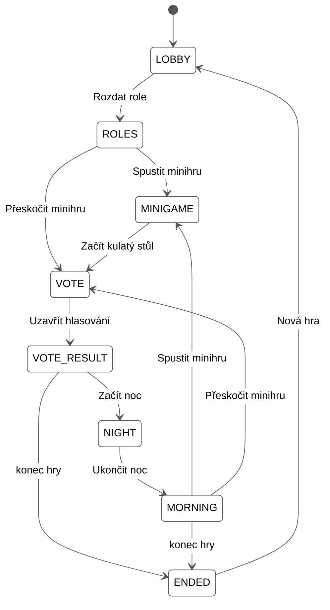
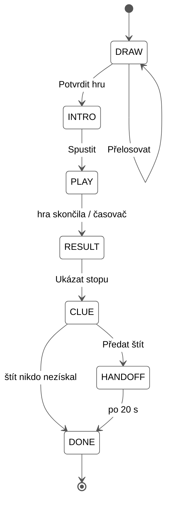
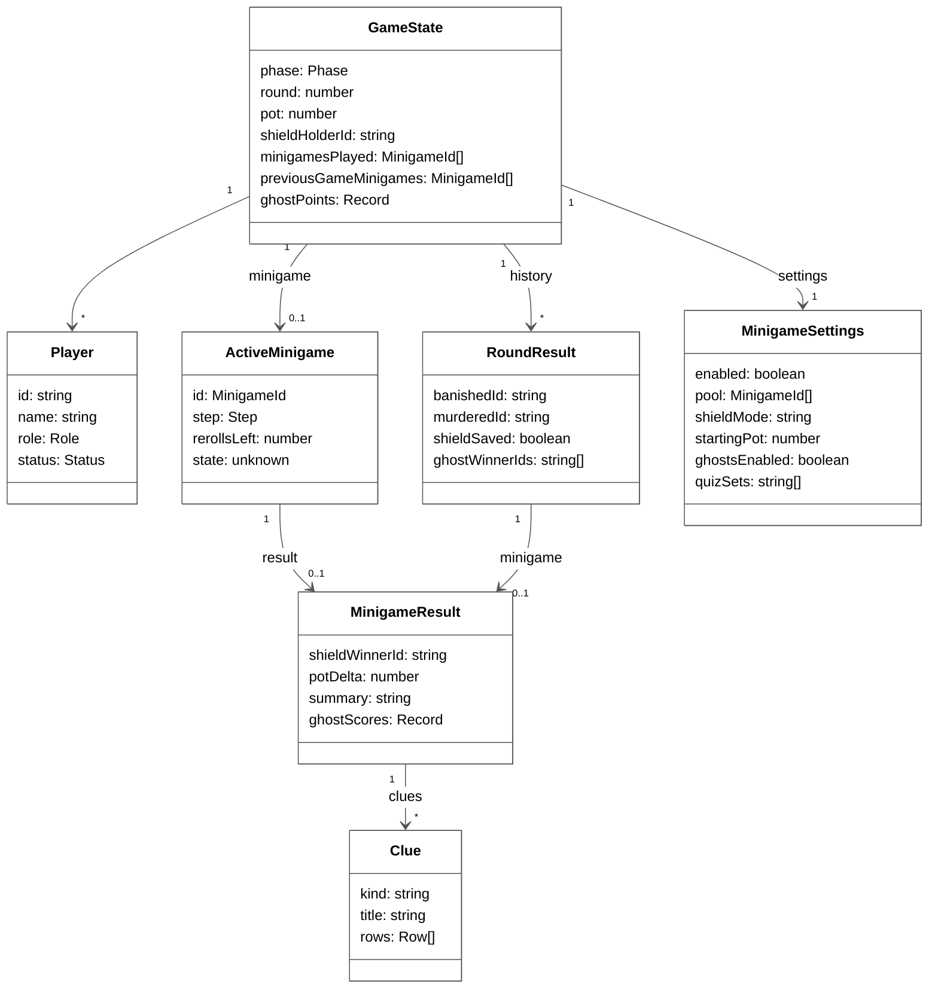

# Zrada – minihry o štít

19. 11. 2026 · doplněna rozhodnutí k otázkám · navazuje na [SPEC.md](SPEC.md), [architektura.md](architektura.md), [zradci-design.md](zradci-design.md) a [zradci-analyza.md](zradci-analyza.md)

## Shrnutí

Každý herní den začne **minihrou na telefonech**, ve které hráči soutěží o **štít**. Štít chrání před umlčením v následující noci. Minihra se vybírá **losem ze 7 her a ve hře se nesmí opakovat**, takže každá hra Zrady je trochu jiná.

| # | Minihra | O co jde | Typ |
| --- | --- | --- | --- |
| 1 | **Trezor** | Poskládat kód z nápověd, které má každý hráč na telefonu | spolupráce + sabotáž |
| 2 | **Zneškodni bombu** | Pyrotechnik vidí bombu, ostatní mají kousky manuálu | spolupráce + sabotáž, časový tlak |
| 3 | **Rytmus** | Všichni ťukají do rytmu, rozhoduje přesnost | dovednost + skrytá rušička |
| 4 | **Tajná aukce** | Tajné nabídky na štít, nabídky se platí ze společného pokladu | psychologie |
| 5 | **Horký brambor** | Bomba koluje mezi telefony a nikdo neví, kdy bouchne | chaos, vyřazovací |
| 6 | **Insider kvíz** | Kvíz, ve kterém Zrádci dostávají pravou nápovědu | znalosti + odhalování |
| 7 | **Rozdělit, nebo ukrást** | Dva hráči se domlouvají a pak tajně volí | duel, důvěra |

K tomu volitelně **fyzická mise**, u které moderátor jen zapíše výsledek.

Tři principy, které z miniher dělají součást hry, a ne jen přestávku:

1. **Zrádci mají v každé minihře motiv nebo výhodu**, kterou mohou nenápadně využít.
2. **Každá minihra zanechá stopu**: veřejná data, která se pak probírají u Kulatého stolu.
3. **Telefony Věrného a Zrádce vypadají i v minihře stejně.** Tajná výhoda Zrádců je schovaná v poli, které má stejný tvar u všech hráčů, nebo v tajné kartě na podržení prstu.

Hru řídí moderátor: **každý den sám rozhodne, jestli minihru spustí, nebo přeskočí**. Minihry provází **velká obrazovka** a po každé minihře na ní **vyhlásí i vítěze mezi duchy**, tedy mezi vyřazenými hráči (viz [Rozhodnutí](#rozhodnutí)).

Odhad vývoje s Claude Code je zhruba 18–22 hodin: 3 hodiny společný rámec, zbytek jednotlivé minihry, scény pro velkou obrazovku a zapojení duchů. Každá minihra je samostatný modul, takže na kurzu je může stavět každý tým zvlášť.

## Principy miniher

1. **Krátké.** Minihra trvá 3–6 minut včetně pravidel. Delší večer nevadí; když je potřeba čas zkrátit, moderátor minihru v daném dni přeskočí.
2. **Server je rozhodčí.** Telefon posílá jen úmysly (ťuknutí, volba, nabídka). Časovač, vyhodnocení i výsledek počítá server, stejně jako ve zbytku hry.
3. **Stejný tvar pohledu pro obě role.** Co Zrádce vidí navíc, dostane Věrný ve stejném poli, jen s jiným, neškodným obsahem. Přes rameno nejde poznat, kdo je kdo.
4. **Tajná karta.** Na začátku minihry dostane každý kartu s pečetí (stejnou jako u rozdání rolí). Zrádce na ní najde svou výhodu, Věrný neutrální text stejné délky.
5. **Pravidla jsou veřejná, i ta o Zrádcích.** Všichni vědí, že Zrádci mají v minihře výhodu, a vědí jakou. Věrní pak mohou cíleně hledat, kdo ji využil. Tím vzniká materiál ke Kulatému stolu.
6. **Stopa.** Po vyhodnocení moderátor spustí krok **Stopa**: zobrazí se data z minihry (kdo měl kterou nápovědu, kdo kolik přihodil, kdo jak ťukal). Stopy z dřívějších dnů si hráč může kdykoli znovu otevřít.
7. **Velká obrazovka provází hrou.** Projektor nebo TV (`/obrazovka`) bude součástí hry: ukazuje los, pravidla, průběh, odhalení, stopu, vítěze mezi duchy a informace pro hráče. Každá minihra proto má vlastní scénu pro obrazovku. Telefony přesto dostávají všechny informace potřebné ke hraní, aby šla minihra dohrát i při výpadku projektoru. Konzoli moderátora promítat nejde, jsou na ní role.
8. **Telefony mlčí a nevibrují kvůli herní informaci.** Podle SPEC telefony nevydávají zvuky. Vibrace navíc na iPhonu v prohlížeči nefungují (Safari nepodporuje Vibration API), takže žádná herní informace nesmí být jen ve vibraci.

## Zařazení do hry

### Nová fáze `MINIGAME`

Minihra je nová fáze na začátku každého dne, mezi rozdáním rolí (nebo ránem) a kulatým stolem. Štít, který v ní někdo získá, platí pro noc téhož kola.



**O minihře rozhoduje moderátor každý den.** Po rozdání rolí a každé ráno má v konzoli dvě stejně velká tlačítka:

- **Spustit minihru**: proběhne los a minihra.
- **Přeskočit minihru**: hra jde rovnou ke kulatému stolu. Ten den se nerozdává štít a minihra se nepočítá jako odehraná, takže zůstává v osudí.

Moderátor tak může tempo večera řídit podle nálady a času. Pod tlačítky vidí, kolik miniher v osudí ještě zbývá. Když jsou minihry v nastavení vypnuté úplně, tlačítko Spustit minihru se neukazuje a hra běží přesně jako dosud (`ROLES → VOTE`, `MORNING → VOTE`).

### Štít

- Za den se rozdá **nejvýš jeden štít**. Některé minihry mohou skončit bez štítu (bomba vybuchne, aukce skončí remízou).
- Štít platí **jen pro noc téhož kola**. Ráno zmizí.
- Když Zrádci v noci vyberou hráče se štítem, **nikdo nezemře**. Ráno všichni uvidí „Tuto noc nikdo nezemřel“. Zrádci se nedozví víc než ostatní.
- Štít může získat i Zrádce. Je mu k ničemu, ale může ho darovat, nebo se jím krýt („já jsem štít vyhrál, tak proč bych byl Zrádce?“).
- **Tajné předání (výchozí):** kdo štít vyhraje, může si ho během 20 s tajně ponechat, nebo ho darovat jinému živému hráči. Ostatní ve stejnou chvíli vidí obrazovku stejného tvaru (viz Předání štítu). Ani v minihře, kde je vítěz všem známý, tak nikdo s jistotou neví, u koho štít skončil.
- Moderátor u hráče se štítem vidí ikonu 🛡, stejně jako v návrhu konzole.

### Poklad

Minihry pracují s **pokladem**, společným číslem pro celou hru.

- Hra začíná s pokladem **1000 bodů** (nastavitelné). Bez počátečního pokladu by aukce v prvním dni neměla z čeho platit.
- Minihry poklad zvyšují (úspěch) nebo snižují (aukce, oba ukradli). Poklad nikdy neklesne pod 0.
- Na konci hry se ukáže „Vítězové si dělí poklad: 1 750 bodů“. Pro Zrádce je proto výhodné poklad během hry tiše snižovat.
- Poklad vidí všichni hráči v hlavičce telefonu a na velké obrazovce.

### Duchové

Režim duchů v aplikaci zatím není, ale bude. Minihry s ním počítají od začátku, aby se nemusely později předělávat.

- **Duch** je vyřazený hráč (vyhnaný nebo umlčený). O štít nesoutěží, ale v každé minihře má **vlastní úlohu**: buď hraje mimo soutěž (kvíz, rytmus), nebo tipuje výsledek (ostatní hry).
- Za úlohu dostává **body duchů**. Ty se sčítají do **žebříčku duchů**, který je trvale v rohu velké obrazovky.
- **Po každé minihře velká obrazovka vyhlásí vítěze mezi duchy** („Mezi duchy vyhrál Filip, +3 body“). Je to součást kroku Výsledek, hned po vyhlášení výsledku minihry. Když duchové ještě nejsou (první den), tento krok se vynechá.
- **Body duchů se počítají jen z veřejných výsledků** (pořadí, výsledek trezoru, nabídky). Nikdy ne z toho, kdo je Zrádce. Jinak by se duch podle svých bodů dozvěděl roli a mohl by ji prozradit ostatním.
- Duch nedostává tajnou kartu ani výhodu Zrádců. Ve svém pohledu nevidí nic, co by neviděli všichni.
- Bodování úloh: tip správně = 3 body, tip „skoro“ (kde to dává smysl) = 1 bod; u her, které duchové hrají, dostane první duch 3 body, druhý 2, třetí 1.

Co přesně duchové v jednotlivých minihrách dělají, je u každé hry v části **Duchové**. Dokud režim duchů není hotový, vyřazení hráči minihry jen sledují.

## Výběr minihry

### Los bez opakování

1. Moderátor ráno (nebo po rozdání rolí) stiskne **Spustit minihru**.
2. Server vybere z osudí hry, které:
   - jsou zapnuté v nastavení,
   - **v této hře ještě nebyly**,
   - mají splněný minimální počet živých hráčů,
   - mají splněné vlastní podmínky (například aukce potřebuje poklad aspoň 200).
3. Z nich vylosuje jednu přes `random.ts`, takže testy mohou los předepsat.
4. Telefony (a velká obrazovka) ukážou krátkou animaci **„Osud vybírá…“**: kolo s názvy zbývajících her, které se zastaví na vylosované.

Hry, které hráči odehráli v **předchozí** hře (před tlačítkem Nová hra), mají při losu nižší váhu (1 místo 3). Kdo hraje víc her za večer, dostane tak co nejvíc různých miniher.

Pokud nevyhovuje žádná hra (všechny se už hrály, nebo je živých hráčů málo), aplikace povolí opakování kromě hry z předchozího dne. Pokud nevyhovuje ani tak, nabídne moderátorovi jen **Přeskočit minihru**.

```ts
function drawMinigame(state: GameState, rng: Rng): MinigameId | null {
  const alive = alivePlayers(state).length;
  const fits = (id: MinigameId) =>
    state.settings.minigames.pool.includes(id) &&
    MODULES[id].meta.minPlayers <= alive &&
    (MODULES[id].canRun?.(state) ?? true);

  let candidates = ALL_MINIGAMES.filter(id => fits(id) && !state.minigamesPlayed.includes(id));
  if (candidates.length === 0) {
    const last = state.minigamesPlayed.at(-1);
    candidates = ALL_MINIGAMES.filter(id => fits(id) && id !== last);
  }
  if (candidates.length === 0) return null;

  const weight = (id: MinigameId) => (state.previousGameMinigames.includes(id) ? 1 : 3);
  return rng.weightedPick(candidates, weight);
}
```

### Zásahy moderátora

| Zásah | Kdy | Proč |
| --- | --- | --- |
| **Přelosovat** | v kroku los, jednou za den | Vylosovaná hra se na místě nehodí (hluk, málo místa) |
| **Vybrat ručně** | v kroku los | Moderátor chce konkrétní hru (předvádění na kurzu) |
| **Přeskočit minihru** | ráno místo Spustit minihru, nebo kdykoli během minihry | Moderátor chce zrychlit večer, nebo minihra nejde dohrát. Žádný štít, poklad beze změny, žádné body duchů, hra se nezapočítá jako odehraná. |
| **Přidělit roli znovu** | během hry | Zámečník, pyrotechnik nebo duelista se odpojil |

### Minimální počty hráčů

| Minihra | Min. živých | Další podmínka |
| --- | --- | --- |
| Trezor | 4 | – |
| Zneškodni bombu | 4 | – |
| Rytmus | 3 | – |
| Tajná aukce | 3 | poklad aspoň 200 |
| Horký brambor | 3 | – |
| Insider kvíz | 3 | v bance je aspoň 7 nepoužitých otázek |
| Rozdělit, nebo ukrást | 3 | – |
| Fyzická mise | 1 | jen když ji moderátor zapne |

## Společný průběh minihry

Každá minihra má stejnou kostru kroků. Mění se jen krok **Hra**.



| Krok | Telefon hráče | Moderátor | Velká obrazovka |
| --- | --- | --- | --- |
| **DRAW** los | animace „Osud vybírá…“, pak název hry | vylosovaná hra, Přelosovat / Vybrat ručně / Potvrdit | animace losu |
| **INTRO** pravidla | název, 3–4 řádky pravidel, pravidlo o výhodě Zrádců a **tajná karta** na podržení | kdo už si tajnou kartu otevřel, tlačítko **Spustit** | pravidla velkým písmem |
| **PLAY** hra | podle minihry | průběh a všechny skryté údaje, Přeskočit | podle minihry |
| **RESULT** výsledek | kdo vyhrál (nebo že nikdo), změna pokladu; duch navíc své body | výsledek, body duchů, tlačítko **Ukázat stopu** | dramatické odhalení, pak **vítěz mezi duchy** a posun v žebříčku duchů |
| **CLUE** stopa | data z minihry | totéž, tlačítko **Předat štít** | totéž ve velkém |
| **HANDOFF** předání štítu | karta s pečetí pro všechny (viz níže) | kdo štít nakonec drží | „Štít je u jednoho z vás“ |
| **DONE** | „Za chvíli začne kulatý stůl“ | tlačítko **Začít kulatý stůl** | klidový stav |

### Tajná karta

Na začátku minihry dostane každý živý hráč kartu s pečetí a text „Podrž pro tajnou zprávu“. Pod pečetí:

- **Zrádce**: konkrétní výhodu pro tuto hru („Tvoje nápověda je falešná. Pravá zní: …“).
- **Věrný**: neutrální text, který má **stejný počet řádků** („Tvoje nápověda je pravdivá. Věř jí, ale ne všem ostatním.“).

V pohledu má karta u obou rolí stejné pole `secretCard: { lines: string[] }` se stejným počtem řádků. Moderátor v kroku INTRO vidí, kdo už si kartu otevřel, a spustí hru, až ji viděli všichni.

### Předání štítu

Všem živým hráčům se zobrazí stejná karta s pečetí „Štít“ a časovač 20 s. Pod pečetí:

- **Vítěz**: „Získal jsi štít. Ponecháš si ho, nebo ho tajně daruješ?“, mřížka živých hráčů a tlačítko **Ponechat si**.
- **Ostatní**: „Štít získal někdo jiný. Komu bys ho svěřil ty?“, stejná mřížka a tlačítko **Nikomu**. Volba se nikam nepočítá, slouží jen k tomu, aby ťukali všichni.

Po 20 s se štít přiřadí. Kdo štít drží, uvidí na podržení pečeti v rohu „Tuto noc tě chrání štít“, ostatní „Štít drží někdo jiný“. Je to stejný mechanismus, jaký má návrh designu pro misi.

V nastavení jde přepnout na **veřejný štít**: krok HANDOFF se vynechá a výsledek minihry rovnou řekne, kdo štít má.

### Stopa

Stopa je seznam veřejných faktů s jednotným tvarem:

```ts
interface Clue {
  kind: 'table' | 'list' | 'chart';
  title: string;            // „Kdo měl kterou nápovědu“
  rows: Array<{ playerId?: string; label: string; value: string }>;
}
```

Ukládá se do historie kola (`history[round].minigame.clues`). Telefon má v hlavičce ikonu **Stopy**, pod kterou jsou stopy všech dosavadních dní, aby se k nim šlo vrátit u kulatého stolu.

## Výchozí nastavení

| Nastavení | Výchozí hodnota | Poznámka |
| --- | --- | --- |
| Minihry zapnuté | ano | Moderátor pak každý den volí Spustit / Přeskočit. Vypnuto = hra jako ve verzi 1. |
| Duchové v minihrách | ano | Platí, až bude hotový režim duchů |
| Osudí | všech 7 miniher | Moderátor může jednotlivé hry vyřadit |
| Fyzická mise v osudí | ne | Zapne se, když je připravený fyzický úkol |
| Štítů za den | 1 | – |
| Režim štítu | tajné předání | Alternativa: veřejný |
| Počáteční poklad | 1000 bodů | – |
| Přelosování | 1× za den | – |
| Délky časovačů | podle tabulek u her | Moderátor je může zkrátit pro rychlou hru |

## Přehled miniher

| Minihra | Délka | Kdo vyhrává štít | Poklad | Stopa | Na velké obrazovce | Duchové | Náročnost |
| --- | --- | --- | --- | --- | --- | --- | --- |
| Trezor | 4–5 min | zámečník zvolený skupinou | +100 až +300 | kdo měl kterou nápovědu | trezor, odpočet, pokusy | tipují, kolikátým pokusem se otevře | střední |
| Zneškodni bombu | 4–5 min | pyrotechnik | +400 | kdo měl kterou stránku manuálu | odpočet a chyby | tipují výsledek a počet chyb | vysoká |
| Rytmus | 3–4 min | nejpřesnější hráč | podle synchronizace, až +300 | graf přesnosti, zda zasáhla rušička | pulzující kruh, synchronizace skupiny | hrají mimo soutěž | střední |
| Tajná aukce | 2–3 min | nejvyšší nabídka | − součet nabídek | všechny nabídky se jmény | odhalování nabídek | tipují součet nabídek | velmi nízká |
| Horký brambor | 3–4 min | poslední přeživší | beze změny | doby držení bomby | kdo drží bombu, výbuchy | tipují posledního přeživšího | nízká |
| Insider kvíz | 3–4 min | nejvíc bodů | podle úspěšnosti, až +300 | rychlé odpovědi po nápovědě | otázky a žebříček | hrají kvíz bez nápovědy | nízká až střední |
| Rozdělit, nebo ukrást | 2–3 min | kdo ukradne, když druhý rozdělí | +300 / 0 / −200 | volby obou duelistů | duelisté a současné odhalení | sázejí jako diváci | velmi nízká |

---

## 1. Trezor

**Koncept:** Trezor má čtyřmístný kód. Každý hráč má na telefonu jednu nápovědu ke kódu. Skupina musí nápovědy nahlas poskládat a zvolený zámečník kód zadá. Zrádci mají na telefonu **falešnou nápovědu**.

### Parametry

| | |
| --- | --- |
| Hráči | 4–10 živých |
| Délka | volba zámečníka 20 s, luštění až 3 min, 3 pokusy |
| Speciální role | **Zámečník**: jediný vidí klávesnici trezoru, sám nápovědu nemá |
| Pravidlo o Zrádcích (veřejné) | „Zrádci mají na telefonu falešnou nápovědu.“ |

### Průběh

1. **Volba zámečníka (20 s):** všichni živí hlasují na telefonu, kdo bude zámečník. Sám sebe volit nejde. Nejvíc hlasů vyhrává, remízu rozhodne los. Zámečník tím vyhraje i šanci na štít, takže volba je test důvěry.
2. **Rozdání nápověd:** server vygeneruje kód a sadu nápověd. Každý hráč kromě zámečníka dostane jednu nápovědu. Ke každé pozici kódu míří aspoň dvě nápovědy od různých hráčů.
3. **Luštění (3 min):** hráči nápovědy čtou nahlas a dohadují se. Zámečník mezitím zkouší kombinace na klávesnici a **Otevřít** zmáčkne, až když si je jistý.
4. **Pokus:** po každém pokusu trezor ukáže jen **počet číslic na správném místě** („2 ze 4“). Zámečník má 3 pokusy.
5. Trezor se otevře, nebo dojdou pokusy či čas.

### Nápovědy

Generátor nejdřív zvolí kód a pak vybírá nápovědy, dokud pravdivé nápovědy dohromady nevedou na **jediné** řešení (kontrola hrubou silou přes 10 000 kombinací je okamžitá). Typy nápověd:

| Typ | Příklad |
| --- | --- |
| Parita | „1. číslice je sudá.“ |
| Rozsah | „3. číslice je větší než 5.“ |
| Vyloučení | „2. číslice není 1, 4 ani 7.“ |
| Vztah dvou pozic | „4. číslice je o 2 menší než 1.“ |
| Součet | „Součet 2. a 3. číslice je 11.“ |
| Přesná hodnota (vzácně, max 1 na kód) | „3. číslice je 8.“ |

**Falešná nápověda Zrádce** má stejný typ a pozici jako jeho pravá nápověda, jen se změněnou hodnotou, a pro skutečný kód neplatí. Na telefonu Zrádce vypadá úplně stejně jako pravá. Zrádce se může rozhodnout ji přečíst nahlas, nebo říct tu pravou (tu má na tajné kartě) a krýt se.

### Tajná karta

- **Věrný:** „Tvoje nápověda je pravdivá. Ostatním věř opatrně.“
- **Zrádce:** „Na telefonu máš falešnou nápovědu. Pravá zní: ‚1. číslice je sudá.‘“

### Vyhodnocení

| Výsledek | Štít | Poklad |
| --- | --- | --- |
| Otevřeno na 1. pokus | zámečník | +300 |
| Otevřeno na 2. pokus | zámečník | +200 |
| Otevřeno na 3. pokus | zámečník | +100 |
| Neotevřeno | nikdo | 0 |

Pokud je zámečník Zrádce, může trezor schválně neotevřít. Stopa pak ukáže, že kód šlo z pravdivých nápověd složit, a podezření padne na něj.

### Stopa

- Skutečný kód a všechny pokusy zámečníka.
- Tabulka **hráč → jeho nápověda (tak, jak ji měl na telefonu)**. U falešných nápověd stopa neříká, že jsou falešné. Hráči je musí najít sami porovnáním s kódem.
- Věta „Z pravdivých nápověd šlo kód složit jednoznačně.“

### Duchové

- Před luštěním tipují, jak to dopadne: **1. pokus / 2. pokus / 3. pokus / neotevře se**.
- Nápovědy hráčů nevidí. Mohli by v nich najít falešnou a poznat tak Zrádce. Slyší jen to, co se říká nahlas, a vidí pokusy zámečníka.
- Body: správný tip 3 body, tip o jeden pokus vedle 1 bod.

### Obrazovky

- **Telefon hráče:** fázový štítek, velká karta s nápovědou (stejná u Věrného i Zrádce), pod ní časovač a počet zbývajících pokusů. Žádné tlačítko, jen čtení.
- **Telefon zámečníka:** klávesnice se čtyřmi okénky, tlačítko **Otevřít trezor**, historie pokusů s výsledkem. Přes rameno je zámečník zřejmý, ale o tom stejně všichni vědí.
- **Moderátor:** kód, všechny nápovědy s označením falešných, pokusy.
- **Velká obrazovka:** trezor se čtyřmi okénky, odpočet, po každém pokusu animace kliknutí zámku a „2 ze 4“.

### Okrajové situace

- **Zámečník se odpojí:** po 20 s nabídne konzole „Přidělit zámečníka znovu“ (los mezi ostatními). Nový zámečník přijde o svou nápovědu, generátor proto přiřazuje nápovědy tak, aby každá pozice měla aspoň dvě.
- **Málo hráčů (4):** 3 nápovědy na 4 pozice nestačí, takže hráči dostanou po dvou nápovědách a kód má jen 3 číslice.
- **Dva Zrádci:** oba mají falešnou nápovědu, ideálně k různým pozicím.

### Technické poznámky

- Generátor a ověření jednoznačnosti je čistá funkce, dobře testovatelná.
- Bot pro simulaci: Věrný čte pravdivě, Zrádce s pravděpodobností 70 % falešně. Bot-zámečník zkouší řešení konzistentní s většinou nápověd.

---

## 2. Zneškodni bombu

**Koncept:** Pyrotechnik vidí na telefonu bombu se třemi moduly a odpočtem. Ostatní hráči mají každý jednu stránku manuálu. Musí pyrotechnika navigovat, aniž by bombu viděli. Na stránkách Zrádců je jedno pravidlo falešné. Inspirace hrou *Keep Talking and Nobody Explodes*.

### Parametry

| | |
| --- | --- |
| Hráči | 4–10 živých |
| Délka | 3 min na bombu, 3 chyby = výbuch |
| Speciální role | **Pyrotechnik** (los mezi živými): jediný vidí bombu |
| Pravidlo o Zrádcích (veřejné) | „Ve stránce manuálu, kterou mají Zrádci, je jedno pravidlo falešné.“ |

### Moduly bomby

Bomba má 3 náhodně vybrané moduly z knihovny. Manuál je předem napsaný (data v JSON) a bomba se generuje náhodně tak, aby se dala manuálem vyřešit.

| Modul | Co pyrotechnik vidí | Co je v manuálu |
| --- | --- | --- |
| **Dráty** | 3–6 barevných drátů | Pravidla podle počtu drátů: „Pokud jsou 4 dráty a víc než jeden červený, přestřihni poslední červený.“ |
| **Tlačítko** | Velké tlačítko s barvou a nápisem | Zda ho ťuknout, nebo podržet; při podržení se rozsvítí proužek a podle jeho barvy se pustí, když je na odpočtu určitá číslice. |
| **Symboly** | 4 tlačítka se symboly | 6 sloupců symbolů; najdi sloupec se všemi čtyřmi a mačkej je v pořadí shora dolů. |
| **Kódový zámek** (rozšíření) | 3 kolečka s písmeny | Seznam platných slov |

### Rozdělení manuálu

- Manuál se skládá ze stránek: každý modul má 1–2 stránky (podle počtu hráčů), celkem 3–6 stránek.
- Stránky se rozdají dokola, aby **každou stránku měli aspoň dva hráči**, pokud je hráčů dost. Pyrotechnik stránku nemá.
- Kopie stránky u Zrádce má **jedno pravidlo s pozměněným výsledkem** (jiný drát, jiná číslice). Vypadá stejně jako pravá.
- Když mají dva hráči stejnou stránku a jeden je Zrádce, při čtení nahlas se pravidla rozejdou. Skupina musí rozhodnout, komu věřit.

### Průběh

1. Los pyrotechnika, rozdání stránek, tajné karty.
2. Moderátor stiskne Spustit, odpočet 3:00 běží na telefonu pyrotechnika a na velké obrazovce. Ostatní mají na telefonu jen svou stránku a malý odpočet nahoře.
3. Pyrotechnik popisuje, co vidí, ostatní hledají pravidla. Pyrotechnik provádí akce (přestřihnout drát, podržet tlačítko, zmáčknout symbol).
4. Špatná akce = **chyba** (blikne, odpočet se zrychlí o 10 %). Třetí chyba nebo nula na odpočtu = výbuch.
5. Všechny moduly vyřešené = bomba zneškodněna.

### Tajná karta

- **Věrný:** „Tvoje stránka manuálu je pravá. Pozor na rozpory.“
- **Zrádce:** „Ve tvé stránce je falešné pravidlo č. 3. Pravé zní: ‚… přestřihni druhý drát.‘“

### Vyhodnocení

| Výsledek | Štít | Poklad |
| --- | --- | --- |
| Zneškodněna | pyrotechnik | +400, minus 100 za každou chybu |
| Výbuch | nikdo | 0 |

Pyrotechnik-Zrádce může bombu schválně odpálit. Stopa ale ukáže, kterou akcí, a jestli ji kryje nějaké pravidlo.

### Stopa

- Seznam chyb: „Chyba 1: modul Dráty, přestřižen 3. drát (správně 4.)“.
- Tabulka **stránka manuálu → kdo ji měl**.
- U každé chyby, zda by ji vysvětlilo falešné pravidlo („Tuto chybu by vysvětlila falešná verze stránky Dráty“). Neříká, čí stránka byla falešná.

### Duchové

- Před spuštěním odpočtu tipují: **zneškodněna bez chyby / s 1 chybou / se 2 chybami / vybuchne**.
- Bombu ani stránky manuálu nevidí. Sledují odpočet a kontrolky chyb jako velká obrazovka.
- Body: správný tip 3 body, tip o jednu chybu vedle 1 bod.

### Obrazovky

- **Telefon pyrotechnika:** bomba přes celou obrazovku, moduly pod sebou, nahoře odpočet a tři kontrolky chyb. Dotykové ovládání: ťuk na drát = přestřihnout (s potvrzením podržením, aby nešlo ťuknout omylem).
- **Telefon ostatních:** stránka manuálu (nadpis modulu, číslovaná pravidla), malý odpočet nahoře. Stránky Věrného a Zrádce mají stejné rozložení i počet pravidel.
- **Moderátor:** bomba, správná řešení, rozdělení stránek včetně falešných.
- **Velká obrazovka:** velký odpočet a kontrolky chyb, ne bomba samotná (jinak by ji viděli i navigátoři).

### Okrajové situace

- **Pyrotechnik se odpojí:** odpočet se pozastaví; po 20 s konzole nabídne přidělit pyrotechnika znovu, nová bomba se negeneruje.
- **Málo hráčů (4):** 3 navigátoři, 3 stránky, žádné duplicity. Rozpor pak není vidět přímo, falešné pravidlo se projeví jen chybou.

### Technické poznámky

- Nejpracnější minihra: data manuálu, generátor bomb a řešitel, který ověří řešitelnost.
- Doporučení: začít se dvěma moduly (Dráty, Symboly) a Tlačítko přidat později. Manuál psát jako data, ne kód, aby šly přidávat varianty.
- Odpočet počítá server. Klient ho jen zobrazuje podle `endsAt` a odhadu rozdílu hodin.
- Bot-pyrotechnik provede správnou akci s pravděpodobností 80 %.

---

## 3. Rytmus

**Koncept:** Všichni ťukají do telefonu přesně do rytmu, který bliká na obrazovce. Hodnotí se přesnost každého hráče i synchronizace celé skupiny. Zrádci mají **rušičku**, která jednomu hráči na jedno kolo posune rytmus, takže pak vypadá jako sabotér.

### Parametry

| | |
| --- | --- |
| Hráči | 3–10 živých |
| Délka | cvičné kolo + 3 kola po 16 dobách, celkem asi 3 min |
| Tempo | kolo 1: 80 BPM, kolo 2: 100 BPM, kolo 3: 120 BPM se synkopou |
| Pravidlo o Zrádcích (veřejné) | „Zrádci mají rušičku. Jednomu hráči na jedno kolo posunou rytmus.“ |

### Průběh

1. **Synchronizace hodin:** telefon a server si vymění 10 krátkých zpráv a server spočítá rozdíl hodin telefonu.
2. **Cvičné kolo (8 dob):** nepočítá se do výsledku. Měří, o kolik se daný telefon a hráč typicky opožďuje (dotykový displej, výkon telefonu), a tuto odchylku pak odečítá. Bez toho by měli hráči s pomalejším telefonem nevýhodu.
3. **Volba před kolem 2 (15 s):** všichni živí vidí stejnou mřížku.
   - Zrádce: „Komu pošleš ozvěnu?“, tedy cíl rušičky. Dva Zrádci mají jednu společnou rušičku a platí volba toho, kdo potvrdil později.
   - Věrný: „Koho budeš chránit?“ Pokud Věrný ochrání hráče, na kterého míří rušička, rušička nezabere.
4. **Kola 1–3:** uprostřed obrazovky pulzuje kruh, každá doba = záblesk. Hráč ťuká kamkoli na obrazovku. Telefony nehrají zvuk, rytmus je jen vizuální (na velké obrazovce může hrát i metronom).
5. Rušička v kole 2 posune cíli zobrazení rytmu o 150 ms. Cíl tak ťuká mimo skutečné doby a vypadá jako sabotér.

### Hodnocení

- Chyba ťuknutí = vzdálenost od nejbližší doby, nejvýš 250 ms. Vynechaná doba = 250 ms.
- **Přesnost hráče** = 100 − (průměrná chyba / 2,5), tedy 0–100 %.
- **Synchronizace skupiny** = průměr přesností všech hráčů.

### Tajná karta

- **Věrný:** „Před 2. kolem můžeš jednoho hráče ochránit před rušičkou.“
- **Zrádce:** „Před 2. kolem pošlete ozvěnu: vybraný hráč bude ťukat mimo.“

### Vyhodnocení

| | |
| --- | --- |
| Štít | hráč s nejvyšší přesností, při shodě ten s menší nejhorší chybou |
| Poklad | +300 × (synchronizace − 50 %) / 50 %, při synchronizaci pod 50 % beze změny |

Zrádci mohou ťukat schválně mimo a snížit poklad, ale ukáže se to v grafu.

### Stopa

- Graf: každý hráč je řádek, každé kolo jedna hodnota přesnosti (tabulka s barevnými pruhy).
- Věta „Rušička zasáhla jednoho hráče“, nebo „Rušičku někdo zablokoval“. **Koho** rušička zasáhla, stopa neříká, takže kdo měl ve 2. kole propad, se může (pravdivě i nepravdivě) hájit, že to byla rušička.

### Duchové

- **Hrají celý rytmus mimo soutěž**, včetně cvičného kola s kalibrací.
- Rušička na ně nepůsobí a neúčastní se volby před 2. kolem (ani ochrany, ani cíle).
- Jejich přesnost se nepočítá do synchronizace skupiny ani do štítu.
- Body: nejpřesnější duch 3 body, druhý 2, třetí 1.

### Obrazovky

- **Telefon:** celá obrazovka je jedna velká dotyková plocha, uprostřed pulzující kruh, nahoře číslo kola a tempo. Po ťuknutí krátký vizuální záblesk na místě dotyku.
- **Moderátor:** živé přesnosti všech hráčů, cíl rušičky a ochrany.
- **Velká obrazovka:** pulzující kruh a metronom, ukazatel synchronizace skupiny v reálném čase.

### Technické poznámky

- **Rozdíl hodin:** `offset = median(serverTime − (t0 + t1) / 2)` z 10 výměn zpráv. Server pošle začátek kola jako čas serveru, telefon si ho převede na vlastní čas a záblesky kreslí přes `requestAnimationFrame`.
- **Čas ťuknutí** se měří přes `performance.now()` v události `pointerdown` (ne `click`, ten má na mobilu zpoždění). Telefon pošle ťuknutí najednou po skončení kola.
- Na místní Wi-Fi je zpoždění sítě zanedbatelné. Rozhoduje odchylka displeje, kterou řeší cvičné kolo.
- Rušička se uplatní jen v klientovi cíle (posun v jeho `view.rhythm.displayOffsetMs`). Pole `displayOffsetMs` má **každý** hráč, u ostatních je 0. Hodnocení na serveru vždy počítá se skutečnými dobami.
- Bot ťuká s náhodnou chybou 20–120 ms.

---

## 4. Tajná aukce

**Koncept:** Každý dostane 10 žetonů a tajně přihodí na štít. Nejvyšší nabídka štít vyhraje, ale **všechny nabídky se platí ze společného pokladu**. Zrádci chtějí poklad vyprázdnit, jenže vysoká nabídka je podezřelá.

### Parametry

| | |
| --- | --- |
| Hráči | 3–10 živých |
| Délka | domluva 60 s, přihazování 30 s, odhalení asi 1 min |
| Kurz | 1 žeton = 50 bodů pokladu |
| Podmínka | poklad aspoň 200 |
| Pravidlo o Zrádcích (veřejné) | „Zrádcům nevadí, když poklad klesne. Spíš naopak.“ |

### Průběh

1. **Domluva (60 s):** hráči se nahlas domlouvají („dejme všichni 1, ať poklad netrpí“).
2. **Přihazování (30 s):** každý zvolí 0–10 žetonů posuvníkem a potvrdí. Do konce časovače jde nabídku změnit. Kdo nepotvrdí, přihodil 0.
3. **Odhalení:** moderátor spouští odhalení nabídek jednu po druhé **od nejnižší po nejvyšší** (stejné nabídky v náhodném pořadí). Na velké obrazovce i telefonech se otočí karta se jménem a číslem.
4. Nejvyšší nabídka vyhrává štít. **Remíza na nejvyšší nabídce = štít nezíská nikdo** („štít zůstává v trezoru“). To motivuje nepřihazovat stejně jako ostatní.
5. Poklad se sníží o součet všech nabídek × 50 (nejvýš na 0).

### Tajná karta

- **Věrný:** „Každý žeton stojí poklad 50 bodů. Šetři.“
- **Zrádce:** „Každý žeton stojí poklad 50 bodů. Čím víc, tím líp, ale nebuď nápadný.“

Karty mají stejný počet řádků. Zrádce nemá žádnou skrytou informaci navíc, jen jiný motiv.

### Vyhodnocení

| | |
| --- | --- |
| Štít | jediná nejvyšší nabídka; při remíze nikdo |
| Poklad | − (součet nabídek × 50) |

### Stopa

- Tabulka **hráč → nabídka**, seřazená od nejvyšší.
- Součet a o kolik se poklad snížil.
- Kdo slíbil během domluvy něco jiného, si hráči pamatují sami. Právě o tom bude kulatý stůl.

### Duchové

- Během přihazování tipují **součet všech nabídek** (0 až 10 × počet živých hráčů).
- Body: nejbližší tip 3 body (při shodě všichni nejbližší), tip vzdálený nejvýš 3 žetony 1 bod.

### Obrazovky

- **Telefon:** velké číslo zvolené nabídky, posuvník 0–10 a tlačítko **Přihodit**. Po potvrzení „Nabídka odevzdána (6/9)“ a možnost změnit.
- **Moderátor:** průběžné nabídky všech, tlačítko **Odhalit další nabídku**.
- **Velká obrazovka:** odhalování karet s nabídkami, poklad, který se na konci „rozsype“ o zaplacenou částku.

### Technické poznámky

- Nejjednodušší minihra, vhodná jako **první modul**, na kterém se ověří celý rámec.
- Bot: Věrný přihodí 0–3, Zrádce 2–7.

---

## 5. Horký brambor

**Koncept:** Na telefonu jednoho hráče tiká bomba. Ťuknutím na jméno ji pošle dál. Kdy bouchne, nikdo neví. U koho bouchne, ten vypadává z minihry. Poslední přeživší získá štít. **Zrádci vidí, kdy se blíží výbuch.**

### Parametry

| | |
| --- | --- |
| Hráči | 3–10 živých |
| Délka | jedno kolo na každého vyřazeného, celkem 2–4 min |
| Rozbuška | náhodně 10–25 s v prvním kole, s každým kolem kratší (nejméně 6–12 s) |
| Pravidlo o Zrádcích (veřejné) | „Zrádcům ukazuje ručička tlaku skutečný čas do výbuchu. Ostatním jen náhodně kmitá.“ |

### Průběh

1. Bomba se objeví u náhodného hráče.
2. Kdo bombu drží, ťukne na jméno v mřížce a bomba přeletí k němu. **Nejde ji poslat zpět tomu, od koho přišla**, aby nevznikal ping-pong mezi dvěma lidmi.
3. Po vypršení rozbušky bomba bouchne. Kdo ji drží, vypadává z minihry (ne ze hry).
4. Krátká pauza 3 s, bomba se objeví u náhodného zbývajícího hráče a začne další kolo s kratší rozbuškou.
5. Poslední hráč, který zbyde, získá štít.

### Výhoda Zrádců

Všechny telefony ukazují **stejnou bombu s ručičkou tlaku**.

- U Zrádců ručička ukazuje skutečný zbývající čas (posledních 5 s je ve značce „kritický“).
- U Věrných ručička náhodně kmitá v celém rozsahu, takže občas ukáže „kritický“, i když není.
- Pole `pressure` (0–1) má v pohledu každý. Přes rameno nejde rozlišit, čí ručička je pravá.

Zrádci se tak bomby zbavují včas a téměř nikdy nebouchnou. Právě to je stopa.

### Tajná karta

- **Věrný:** „Tvoje ručička tlaku lže. Spoléhej na štěstí.“
- **Zrádce:** „Tvoje ručička tlaku je pravá. Červené pole = zbývá méně než 5 s.“

### Vyhodnocení

| | |
| --- | --- |
| Štít | poslední přeživší |
| Poklad | beze změny |

Když zbydou dva Zrádci, štít jednomu z nich připadne a v tajném předání ho může darovat.

### Stopa

- Pořadí vyřazení („1. Jana, 2. Karel, …“).
- Tabulka **hráč → kolikrát se bomby zbavil v posledních 3 s před výbuchem** a **průměrná doba držení**. Kdo se opakovaně zbavuje bomby těsně před výbuchem, je podezřelý. Může to ale být i štěstí.

### Duchové

- Před první bombou tipují **posledního přeživšího** a **prvního, u koho bouchne**.
- Ručičku tlaku nemají. Vidí jen, kdo bombu drží.
- Body: správný poslední přeživší 3 body, správný první vyřazený 1 bod.

### Obrazovky

- **Telefon s bombou:** velká bomba s doutnákem, ručička tlaku, pod ní mřížka jmen a výzva „Pošli ji dál!“.
- **Telefon bez bomby:** stejné rozložení, bomba je malá a šedá, nahoře „Bombu má: Karel“, mřížka neaktivní. Ručičku tlaku mají i hráči bez bomby, aby Zrádci viděli čas, i když bombu zrovna nedrží.
- **Vyřazený z minihry:** „Bouchlo to u tebe“, dál sleduje, kdo bombu drží.
- **Moderátor:** kdo drží bombu, skutečný čas do výbuchu.
- **Velká obrazovka:** jméno držitele velkým písmem, výbuch s animací.

### Okrajové situace

- **Držitel se odpojí:** bomba po 3 s automaticky přeskočí k náhodnému připojenému hráči. Rozbuška běží dál.
- **Jen 3 hráči:** po prvním výbuchu zbývají dva a bomba se nesmí vracet. Pravidlo „ne zpět odesílateli“ v souboji dvou hráčů neplatí.

### Technické poznámky

- Rozbušku a čas výbuchu zná jen server. Do pohledu jde jen `pressure`.
- Náhodné kmitání u Věrných počítá server, ne klient, aby stejné pole nemělo v kódu klienta dvě různé větve.
- Bot: drží bombu 1–4 s. Bot-Zrádce ji pošle dál, když `pressure > 0,8`.

---

## 6. Insider kvíz

**Koncept:** Kvíz se 7 otázkami a čtyřmi možnostmi. Po 3 s se u jedné možnosti objeví **nápověda**. U Zrádců ukazuje správnou odpověď, u Věrných náhodnou. Zrádce, který vždycky hned odpoví správně, se prozradí.

### Parametry

| | |
| --- | --- |
| Hráči | 3–10 živých |
| Délka | 7 otázek × 15 s + odhalení, asi 3 min |
| Nápověda | po 3 s od zobrazení otázky |
| Pravidlo o Zrádcích (veřejné) | „Nápověda ukazuje Zrádcům správnou odpověď. Věrným ukazuje náhodnou.“ |

### Průběh

1. Na všech telefonech (a velké obrazovce) se zobrazí otázka a 4 možnosti.
2. Po 3 s se u jedné možnosti rozsvítí malá **svíčka** (nápověda). U Věrného náhodně, u Zrádce u správné odpovědi.
3. Hráč ťukne na odpověď. Odpověď nejde změnit.
4. Po 15 s nebo po odpovědi všech se ukáže správná odpověď a průběžné pořadí.

### Body

- Správně: 100 bodů + bonus za rychlost až 50 (lineárně od 0 s do 15 s).
- Špatně nebo bez odpovědi: 0.

### Otázky

- **Banka otázek** je samostatná složka `server/minigames/quiz/questions/`. Každá **sada** je jeden soubor JSON (`obecne.cs.json`, `zabava.cs.json`, `cesko.cs.json`). Pro začátek stačí obecná banka zhruba 60 otázek, aby vydržela několik večerů bez opakování.
- **Připraveno pro další použití:** formát sady nezávisí na Zradě (nemá v sobě nic o rolích ani nápovědách), takže stejné sady půjde později použít jinde, například tematickou sadu o hradech pro Storyhold. Zatím se nic takového nedělá, jen se na to nezavírají dveře.
- **Výběr sad:** moderátor v nastavení zaškrtne, které sady se používají (výchozí: všechny obecné).
- **Vlastní otázky zákazníka:** moderátor může před hrou vložit vlastní sadu JSON (otázky o firmě, o eventu). Má přednost před ostatními.
- Otázky použité v jedné hře se do konce večera neopakují (seznam v paměti serveru).
- **Rozšíření:** v lobby každý hráč odpoví na 2 rychlé otázky („Pes, nebo kočka?“) a kvíz se pak ptá „Kolik z vás má radši psy?“. Tak vznikají otázky šité na konkrétní skupinu.

Formát otázky:

```json
{
  "set": "cesko",
  "name": "Česko",
  "lang": "cs",
  "questions": [
    { "id": "cesko-012", "text": "Které město leží na soutoku Ohře a Teplé?",
      "options": ["Loket", "Karlovy Vary", "Sokolov", "Cheb"], "correct": 1, "difficulty": 1 }
  ]
}
```

### Tajná karta

- **Věrný:** „Tvoje nápověda je náhodná. Spoléhej na sebe.“
- **Zrádce:** „Tvoje nápověda je vždy správná. Nebuď ale až moc dobrý.“

### Vyhodnocení

| | |
| --- | --- |
| Štít | nejvíc bodů, při shodě menší součet časů odpovědí |
| Poklad | +300 × podíl správných odpovědí všech hráčů |

### Stopa

- Konečné pořadí s body.
- Tabulka **hráč → kolik odpovědí dal do 1,5 s po rozsvícení nápovědy a kolik z nich bylo správně**. Kdo odpovídá rychle hned po nápovědě a skoro vždy správně, je podezřelý.

### Duchové

- **Hrají stejný kvíz mimo soutěž**, se stejnými otázkami a body za rychlost.
- Nápovědu (svíčku) nemají vůbec. Jejich status je veřejný, takže jejich obrazovka se od hráčů smí lišit.
- Mají vlastní pořadí, které se neplete do pořadí o štít.
- Body: nejlepší duch 3 body, druhý 2, třetí 1.

### Obrazovky

- **Telefon:** otázka nahoře, čtyři velké dlaždice odpovědí pod sebou, malá svíčka u jedné z nich, časovač. Po odpovědi „Odpověď zamčena“.
- **Moderátor:** otázka, správná odpověď, kdo odpověděl a jak, kde mají Věrní náhodné nápovědy.
- **Velká obrazovka:** otázka a možnosti velkým písmem (bez nápovědy), odpočet, po otázce správná odpověď a žebříček.

### Technické poznámky

- Nápovědu (`hintIndex`) posílá server až po 3 s jako změnu pohledu. Má ji každý hráč, u Věrného náhodnou (může být i správná).
- Klient nesmí dostat `correct` dřív, než otázka skončí. Správná odpověď jde do pohledu až v mezikroku po otázce.
- Bot: Věrný odpoví správně se 60 %, Zrádce se 70 % řídí nápovědou.

---

## 7. Rozdělit, nebo ukrást

**Koncept:** Dva vylosovaní hráči stojí naproti sobě, minutu se nahlas domlouvají a pak tajně zvolí **Rozdělit**, nebo **Ukrást**. Ostatní sázejí, jak to dopadne. Čisté drama tváří v tvář.

### Parametry

| | |
| --- | --- |
| Hráči | 3–10 živých (2 duelisté, ostatní diváci) |
| Délka | domluva 60 s, volba 10 s, odhalení, celkem asi 2 min |
| Výběr duelistů | los mezi živými; kdo už ve hře duelistou byl, má nižší šanci |
| Pravidlo o Zrádcích | žádné zvláštní. Zrádcům štít nic nedá, ale krádež poškodí důvěru, a to se jim hodí. |

### Průběh

1. Los dvou duelistů. Telefony a velká obrazovka je ukážou.
2. **Domluva (60 s):** duelisté si stoupnou naproti sobě a nahlas přesvědčují jeden druhého. Ostatní mohou přihazovat komentáře. Moderátor může domluvu ukončit dřív.
3. **Volba (10 s):** duelisté zvolí na telefonu **Rozdělit**, nebo **Ukrást**. Kdo nezvolí, rozděluje.
4. **Sázky diváků** (ve stejných 10 s): „Oba rozdělí“, „Jeden ukradne“, nebo „Oba ukradnou“.
5. **Odhalení:** moderátor spustí současné otočení obou karet.

### Výsledky

| Duelista A | Duelista B | Štít | Poklad |
| --- | --- | --- | --- |
| Rozdělit | Rozdělit | nikdo | +300 |
| Ukrást | Rozdělit | A | 0 |
| Rozdělit | Ukrást | B | 0 |
| Ukrást | Ukrást | nikdo | −200 |

Za každou správnou sázku diváka jde do pokladu +20.

### Tajná karta

- **Věrný (duelista i divák):** „Rozdělit pomáhá všem. Ukrást pomáhá jen tobě.“
- **Zrádce:** „Rozdělit pomáhá Věrným. Ukrást rozbíjí důvěru.“

### Stopa

- Volby obou duelistů.
- Co kdo během domluvy slíbil, si hráči pamatují sami.
- Sázky diváků se jmény. Kdo vsadil na „Jeden ukradne“, možná věděl víc.

### Duchové

- Sázejí stejně jako živí diváci, ale přesněji: **oba rozdělí / ukradne A / ukradne B / oba ukradnou**.
- Jejich sázky nepřidávají body do pokladu.
- Body: přesná sázka 3 body, správně „někdo ukradl“, ale špatný duelista, 1 bod.

### Obrazovky

- **Telefon duelisty:** během domluvy jméno soupeře a časovač; během volby dvě velké karty pod sebou, **Rozdělit** a **Ukrást**, obě stejně výrazné.
- **Telefon diváka:** během domluvy totéž; během volby tři karty se sázkami. Rozložení se liší počtem karet, ale role duelisty je veřejná, takže to nic neprozrazuje.
- **Moderátor:** volby a sázky průběžně, tlačítko **Odhalit**.
- **Velká obrazovka:** dvě portrétové karty, které se po odhalení současně otočí.

### Technické poznámky

- Velmi jednoduchá logika, vhodná jako druhý modul.
- **Varianta pro 8 a více hráčů:** dva duely za sebou. Štít pak připadne jen hráči z prvního duelu, který ukradl, aby za den zůstal nejvýš jeden.
- Bot: rozdělí se 70 %, Zrádce se 50 %.

---

## Fyzická mise (moderátorský modul)

Není to minihra na telefonech, ale stejný modul se stejným rozhraním. Jde vylosovat, když ji moderátor zapne v nastavení.

1. Moderátor napíše zadání mise (text se ukáže na telefonech a velké obrazovce).
2. Hráči plní úkol fyzicky (stavění věže, šifra po místnosti, štafeta).
3. Moderátor zapíše výsledek: změnu pokladu a hráče, který získá štít (nebo nikoho).
4. Stopa je volitelný text, který moderátor napíše („Petra upustila klíč dvakrát“).
5. Duchové: moderátor může jednomu duchovi přidělit 3 body (například za pomoc s rozhodováním nebo za nejlepší tip), nebo body neudělí.

Návaznost na předání štítu a historii kol je stejná jako u ostatních miniher.

---

## Technické řešení

Navazuje na [architektura.md](architektura.md): herní jádro jako čisté funkce, stav v paměti, pohledy počítané pro každého hráče zvlášť a Socket.IO.

### Struktura souborů

```
server/
├─ game/
│  ├─ engine.ts              + větev pro fázi MINIGAME, štít v noci
│  ├─ rules.ts               + vyhodnocení noci se štítem
│  ├─ views.ts               + skládá pohled minihry do PlayerView / ModeratorView / ScreenView
│  └─ random.ts              + weightedPick
└─ minigames/
   ├─ types.ts               rozhraní MinigameModule, Clue, MinigameResult
   ├─ registry.ts            MODULES: Record<MinigameId, MinigameModule>
   ├─ draw.ts                los bez opakování
   ├─ framework.ts           společné kroky DRAW → INTRO → PLAY → RESULT → CLUE → HANDOFF → DONE
   ├─ vault/                 Trezor: index.ts, generator.ts, __tests__/
   ├─ bomb/                  Bomba: index.ts, manual.cs.json, generator.ts, solver.ts
   ├─ rhythm/                Rytmus
   ├─ auction/               Tajná aukce
   ├─ hotPotato/             Horký brambor
   ├─ quiz/                  Insider kvíz: index.ts, questions/ (sady otázek v JSON)
   ├─ splitSteal/            Rozdělit, nebo ukrást
   └─ physical/              Fyzická mise
client/
├─ minigames/
│  ├─ MinigameShell.tsx      společná kostra: los, pravidla, tajná karta, výsledek, stopa, předání štítu
│  ├─ registry.ts            mapování MinigameId → komponenty
│  ├─ vault/                 PlayerView.tsx, GhostView.tsx, ModeratorPanel.tsx, ScreenView.tsx
│  └─ …                      stejně pro ostatní hry
└─ components/
   ├─ SealedCard.tsx         karta s pečetí (už existuje, znovu použít)
   ├─ Countdown.tsx          časovač podle endsAt a rozdílu hodin
   ├─ ClueView.tsx           vykreslení stopy (tabulka, seznam, pruhy)
   ├─ GhostTip.tsx           společná obrazovka tipu ducha (výběr z možností nebo hráčů)
   └─ GhostWinner.tsx        scéna „Vítěz mezi duchy“ pro velkou obrazovku
```

### Rozhraní modulu

```ts
export type MinigameId =
  | 'VAULT' | 'BOMB' | 'RHYTHM' | 'AUCTION' | 'HOT_POTATO' | 'QUIZ' | 'SPLIT_STEAL' | 'PHYSICAL';

export interface MinigameContext {
  players: Array<{ id: string; role: Role; alive: boolean }>;
  ghosts: string[];                // id vyřazených hráčů; prázdné, dokud není režim duchů
  pot: number;
  round: number;
  settings: MinigameSettings;
}

export interface MinigameResult {
  shieldWinnerId: string | null;   // před předáním štítu
  potDelta: number;
  summary: string;                 // „Trezor otevřen na 2. pokus“
  clues: Clue[];
  ghostScores: Record<string, number>;  // body duchů za tuto minihru, jen z veřejných výsledků
}

export interface MinigameModule<S, A> {
  id: MinigameId;
  meta: { name: string; minPlayers: number; estMinutes: number; rules: string[]; traitorRule: string };
  canRun?(game: GameState): boolean;

  init(ctx: MinigameContext, rng: Rng, now: number): S;
  secretCard(state: S, playerId: string): { lines: string[] };   // stejný počet řádků pro obě role
  apply(state: S, playerId: string, action: A, now: number, rng: Rng): S; // neplatná akce = beze změny
  tick(state: S, now: number, rng: Rng): S;                       // časovače
  isFinished(state: S): boolean;
  result(state: S): MinigameResult;

  viewForPlayer(state: S, playerId: string): unknown;   // nesmí obsahovat cizí roli ani výhodu Zrádců u Věrného
  viewForModerator(state: S): unknown;
  viewForScreen(state: S): unknown;                     // jen veřejné informace, scéna pro projektor

  // Duchové (volitelné, dokud není režim duchů)
  applyGhost?(state: S, ghostId: string, action: A, now: number): S;  // tip nebo hra mimo soutěž
  viewForGhost?(state: S, ghostId: string): unknown;                  // jen veřejné informace + vlastní úloha

  botAction(state: S, playerId: string, role: Role, rng: Rng, now: number): A | null;  // pro simulace
  botGhostAction?(state: S, ghostId: string, rng: Rng, now: number): A | null;
}
```

Každý modul je čistý: nedělá síť ani časovače, čas dostává jako parametr `now`. Díky tomu jde každou minihru testovat samostatně a simulovat s boty.

Funkce pro duchy jsou v rozhraní volitelné. Rámec je volá jen tehdy, když je režim duchů hotový a zapnutý. Modul bez nich funguje dál a duchové ho jen sledují. Vítěze mezi duchy počítá rámec, ne modul: z `ghostScores` vybere nejvyšší hodnotu (při shodě vyhlásí všechny) a přičte body do žebříčku.

### Stav

Hra dál nemá databázi. Do `GameState` přibudou tato pole:

```ts
interface GameState {
  // … stávající pole
  pot: number;
  shieldHolderId: string | null;         // platí pro noc aktuálního kola
  minigamesPlayed: MinigameId[];         // v této hře, kvůli losu bez opakování
  previousGameMinigames: MinigameId[];   // z minulé hry, nižší váha při losu
  minigame: ActiveMinigame | null;
  ghostPoints: Record<string, number>;   // žebříček duchů za celou hru
}

interface ActiveMinigame {
  id: MinigameId;
  step: 'DRAW' | 'INTRO' | 'PLAY' | 'RESULT' | 'CLUE' | 'HANDOFF' | 'DONE';
  rerollsLeft: number;
  secretCardSeen: Record<string, boolean>;
  state: unknown;                        // stav konkrétního modulu
  result: MinigameResult | null;
  handoff: { winnerId: string; picks: Record<string, string | null>; endsAt: number } | null;
}

interface RoundResult {
  // … stávající pole
  minigame?: { id: MinigameId; summary: string; clues: Clue[]; potDelta: number;
               ghostWinnerIds: string[] };
  shieldSaved?: boolean;                 // Zrádci vybrali hráče se štítem
}

interface MinigameSettings {
  enabled: boolean;
  pool: MinigameId[];
  includePhysical: boolean;
  shieldMode: 'SECRET_HANDOFF' | 'PUBLIC';
  startingPot: number;
  rerollsPerDay: number;
  timeScale: number;                     // 1 = výchozí délky, 0,7 = rychlejší hra
  ghostsEnabled: boolean;                // duchové hrají a tipují
  quizSets: string[];                    // zapnuté sady otázek
}
```

Struktura stavu (třídní diagram místo ER diagramu, protože hra databázi nemá):



### Akce

Nové akce v jádru. Hráči posílají **jednu společnou zprávu** `minigameInput` pro všechny minihry i obě role, aby provoz v síti nic neprozradil (stejný princip jako `nightPick`).

| Akce | Kdo | Krok | Co udělá |
| --- | --- | --- | --- |
| `drawMinigame` | moderátor | ROLES, MORNING | Tlačítko **Spustit minihru**: fáze MINIGAME, krok DRAW, los |
| `skipMinigameToday` | moderátor | ROLES, MORNING | Tlačítko **Přeskočit minihru**: rovnou fáze VOTE, nic se nelosuje |
| `rerollMinigame` | moderátor | DRAW | Nový los, pokud zbývá přelosování |
| `chooseMinigame { id }` | moderátor | DRAW | Ruční výběr |
| `confirmMinigame` | moderátor | DRAW | Krok INTRO, `init` modulu, tajné karty |
| `ackSecretCard` | hráč | INTRO | Odškrtne, že kartu viděl |
| `startMinigame` | moderátor | INTRO | Krok PLAY |
| `minigameInput { payload }` | živý hráč, duch | PLAY | Hráč: `module.apply`. Duch: `module.applyGhost`, pokud jsou duchové zapnutí. |
| `minigameModerator { payload }` | moderátor | PLAY | Zásahy specifické pro hru (odhalit další nabídku, přidělit roli znovu) |
| `tick { now }` | server | PLAY, HANDOFF | Posune časovače, případně ukončí hru |
| `showGhostWinner` | moderátor | RESULT | Velká obrazovka vyhlásí vítěze mezi duchy a přičte body do žebříčku (jen když jsou duchové) |
| `showClue` | moderátor | RESULT | Krok CLUE, uloží výsledek a stopu do historie, změní poklad |
| `startHandoff` | moderátor | CLUE | Krok HANDOFF (jen při tajném předání a když je vítěz) |
| `handoffPick { targetId \| null }` | živý hráč | HANDOFF | U vítěze určí držitele štítu, u ostatních se zahodí |
| `skipMinigame` | moderátor | kdykoli | Krok DONE bez štítu a beze změny pokladu |
| `startVote` | moderátor | DONE | Stávající akce, nově povolená i z MINIGAME |

### Časovače

Herní jádro zůstává čistou funkcí. Časovače řeší server:

- Během fáze MINIGAME server každých 200 ms pošle do jádra akci `tick { now: Date.now() }`.
- Moduly ukládají konce časovačů jako absolutní čas serveru (`endsAt`). Ten jde i do pohledu.
- Klient si při připojení spočítá rozdíl svých hodin a hodin serveru (stejná metoda jako v Rytmu, jen hrubší) a časovač kreslí podle `endsAt − offset`.
- V testech se `tick` volá s umělým časem, takže se celá minihra přehraje okamžitě.

Posílání pohledu po každém `tick` by bylo zbytečné. Server rozešle pohledy jen tehdy, když se změnil stav (porovná verzi stavu). Odpočty si klient kreslí sám.

### Pohledy a utajení

Pravidla z architektury platí i pro minihry a přibývají tři:

1. **Stejný tvar.** `viewForPlayer` minihry má pro Věrného i Zrádce stejná pole stejných typů. Výhoda Zrádců je jen jiná hodnota ve sdíleném poli (`pressure`, `hintIndex`, `clueText`, `displayOffsetMs`).
2. **Žádná budoucnost.** Do pohledu nejde nic, co se hráč nemá dozvědět předem: správná odpověď kvízu, čas výbuchu, kód trezoru.
3. **Tajná karta jen na podržení.** Text výhody je v pohledu jen v `secretCard` a klient ho ukáže jen při podrženém prstu.

Testy navíc:

- **Test tvaru:** pro každou minihru a každý krok simulace porovná klíče pohledu Věrného a Zrádce rekurzivně. Musí být shodné, stejně jako počet řádků tajné karty.
- **Test úniku:** pohled Věrného nikdy neobsahuje kód trezoru, `correct` kvízu před koncem otázky, skutečný `fuseEndsAt` ani pravidla falešných stránek.
- **Test obrazovky:** `viewForScreen` nikdy neobsahuje role ani výhody Zrádců.
- **Test duchů:** `viewForGhost` nikdy neobsahuje role, výhody Zrádců ani nápovědy a stránky jednotlivých hráčů. Body duchů se pro stejný průběh minihry nezmění, když se Zrádcem stane někdo jiný.

## Testování

| Úroveň | Co se ověřuje |
| --- | --- |
| Jednotkové testy modulů | Generátor trezoru vždy dá jednoznačné řešení; řešitel bomby vyřeší každou vygenerovanou bombu; hodnocení rytmu, aukce (remíza na vrcholu), duelu (všechny 4 kombinace); kvíz neprozradí správnou odpověď |
| Los | 1000 losů: nikdy stejná hra dvakrát v jedné hře, respektuje minimální počty hráčů i podmínky (aukce bez pokladu) |
| Štít v noci | Zrádci zvolí hráče se štítem → nikdo nezemře, štít ráno zmizí |
| Simulace s boty | Celá hra s minihrami, 5–10 botů, 200 opakování s různým losem. Hra vždy skončí, nikdy se nezasekne, poklad nikdy není záporný |
| Utajení | Test tvaru, test úniku, test obrazovky a test duchů v každém kroku simulace |
| Moderátor | Spustit / Přeskočit každý den; přeskočená minihra zůstává v osudí |
| Duchové | Simulace s boty-duchy: body se přičítají do žebříčku, vítěz mezi duchy se určí i při shodě |
| Ruční test | 5 karet `/?hrac=1` až `/?hrac=5`, každá minihra aspoň jednou |
| Zkouška s telefony | Rytmus na různých telefonech (iPhone i Android) kvůli kalibraci, bomba a trezor kvůli čitelnosti na malém displeji |

## Plán vývoje

Odhady počítají s vývojem s Claude Code, stejně jako v [architektura.md](architektura.md).

| # | Krok | Obsah | Hotovo, když | Odhad |
| --- | --- | --- | --- | --- |
| 1 | **Rámec miniher** | Fáze MINIGAME, `types.ts`, `registry.ts`, `framework.ts`, `tick`, tajná karta, stopa, historie | Prázdná testovací minihra projde všemi kroky | 2 h |
| 2 | **Štít a poklad** | Předání štítu, štít v noci, poklad v pohledech a na konci hry | Test „Zrádci zvolí hráče se štítem“ prochází | 1 h |
| 3 | **Los a řízení moderátorem** | `draw.ts`, tlačítka Spustit / Přeskočit minihru, animace losu, přelosování, ruční výběr | Test losu prochází, moderátor řídí minihry jen tlačítky | 45 min |
| 4 | **Tajná aukce** | První skutečný modul, ověří celý rámec | Hra s 5 kartami prohlížeče | 45 min |
| 5 | **Rozdělit, nebo ukrást** | Duel, sázky, odhalení | Odehraje se v 5 kartách prohlížeče | 45 min |
| 6 | **Horký brambor** | Předávání bomby, rozbuška, ručička tlaku | Odehraje se v 5 kartách prohlížeče | 1,5 h |
| 7 | **Insider kvíz** | Otázky, nápověda, body, sady otázek, obecná banka asi 60 otázek | Odehraje se v 5 kartách prohlížeče | 2 h |
| 8 | **Trezor** | Generátor nápověd, volba zámečníka, klávesnice | Odehraje se v 5 kartách prohlížeče | 2 h |
| 9 | **Rytmus** | Synchronizace hodin, kalibrace, kola, rušička | Zkouška na 4 různých telefonech | 2,5–3 h |
| 10 | **Zneškodni bombu** | Manuál jako data, generátor, řešitel, 2–3 moduly | Odehraje se v 5 kartách prohlížeče | 3–4 h |
| 11 | **Scény na velkou obrazovku** | `viewForScreen` a `ScreenView` pro všechny minihry a společné kroky (los, pravidla, výsledek, stopa) | Celá minihra jde sledovat na TV bez pohledu do telefonu | 2 h |
| 12 | **Duchové v minihrách** | `applyGhost`, `viewForGhost`, tipy a body, scéna „Vítěz mezi duchy“, žebříček | Po každé minihře se na obrazovce ukáže vítěz mezi duchy | 2 h |
| 13 | **Zkouška naživo** | Celý večer s 6–8 lidmi, všechny minihry | Každá minihra aspoň jednou bez zaseknutí | 1 h |

**Celkem zhruba 18–22 hodin.** Pořadí jde od nejjednodušší po nejsložitější. Po kroku 5 už hra s minihrami funguje a každá další minihra přidává rozmanitost.

**Návaznost na ostatní práci:** krok 11 předpokládá, že velká obrazovka (`/obrazovka`, `viewForScreen`) už v základní hře existuje; minihry k ní jen přidávají své scény. Krok 12 předpokládá hotový režim duchů. Do té doby se oba kroky dají odložit a minihry fungují bez nich.

### Nápad pro vibecoding kurz

Rámec (kroky 1–3) připraví lektor předem. Na kurzu pak každý tým dostane jednu minihru: tuto analýzu, rozhraní `MinigameModule` a testovací kostru. Moduly na sobě nezávisí, takže na konci kurzu se spojí do jedné hry a odehraje se společný večer, kde se losuje ze všech miniher, které týmy postavily. Pořadí obtížnosti pro rozdělení týmů: aukce, duel, brambor (začátečníci); kvíz, trezor (pokročilí); rytmus, bomba (zkušení).

## Rozhodnutí

Odpovědi na otázky z první verze analýzy (19. 11. 2026):

| Otázka | Rozhodnutí | Kde se to v dokumentu projevilo |
| --- | --- | --- |
| **Délka večera** | Delší hra nevadí. Moderátor má každý den tlačítka **Spustit minihru** a **Přeskočit minihru** a sám koordinuje tempo večera. | Fáze `MINIGAME`, Zásahy moderátora, akce `drawMinigame` a `skipMinigameToday`, plán krok 3 |
| **Velká obrazovka** | Bude součástí hry. Slouží k procházení hrou a jako informace pro hráče. | Princip 7, tabulka Přehled miniher, scény u každé hry, plán krok 11 |
| **Banka otázek kvízu** | Udělat. Zatím obecná, mimo Storyhold, ale formát sad připravený i pro pozdější tematické sady. | Insider kvíz, Otázky; nastavení `quizSets` |
| **Režim duchů** | Bude. Duchové mají v každé minihře vlastní úlohu a po každé minihře se na obrazovce ukáže vítěz mezi duchy. | Zařazení do hry, Duchové; část Duchové u každé hry; rozhraní modulu; plán krok 12 |

Otevřené zůstává jen to, co přijde s dalšími částmi hry: přesný vzhled žebříčku duchů a jak se body duchů promítnou na konci hry (například vyhlášení nejlepšího ducha večera).
