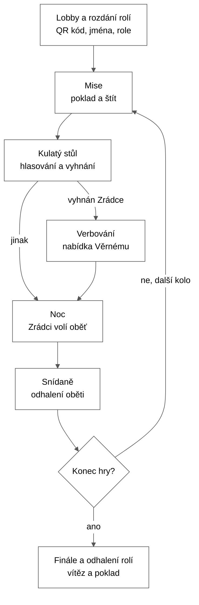
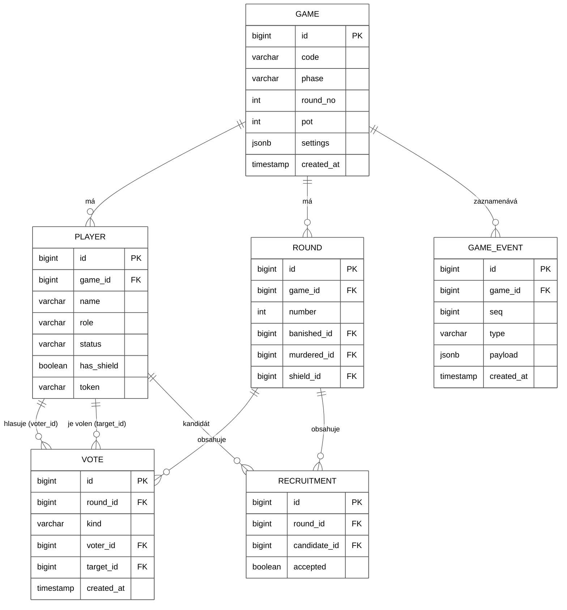

# Zrádci na telefonech – analýza

5. 11. 2026 · Michal

## Shrnutí

Zrádce na telefonech udělat jde a pro 10 hráčů je to technicky malá aplikace. Telefon nahradí obálky s rolemi, lístečky na hlasování a moderátorovo počítání; lidé dál sedí spolu a hádají se naživo, což je jádro zábavy.

Doporučení:

- **Webová aplikace (PWA), žádná instalace** – hráč naskenuje QR kód, zadá jméno a je ve hře.
- **Tři pohledy**: telefon hráče, konzole moderátora a volitelně velká obrazovka (TV/projektor) pro dramatická odhalení.
- **Server rozhoduje o všem** – role, hlasy i výsledky zná jen server, telefon dostane jen to, co smí vidět jeho majitel.
- **Běh na stávajícím WEDOS VPS** jako samostatná aplikace vedle Storyhold, ve stejném stacku (Spring Boot, React, PostgreSQL).

Není to úplně mimo vaše zaměření: česká verze pořadu se točila na hradě Křivoklát, takže hra se dá později nabízet i jako večerní program na hradech.

## Pravidla hry v kostce

Zrádci jsou televizní verze hry Městečko Palermo (Mafie): tajná menšina likviduje většinu a většina ji musí odhalit hlasováním.

1. **Role** – hráči jsou tajně rozděleni na Věrné a Zrádce. Zrádci se navzájem znají, Věrní neví kdo ani kolik jich je.
2. **Den a mise** – společné úkoly, které zvětšují poklad. Za misi lze získat štít, který na jednu noc chrání před vraždou.
3. **Kulatý stůl** – diskuse a hlasování. Kdo dostane nejvíc hlasů, je vyhnán a prozradí svou roli.
4. **Noc** – Zrádci společně vyberou jednoho Věrného, kterého „zavraždí“. Ostatní to zjistí ráno u snídaně.
5. **Verbování** – když Zrádce přijde o spolužáce, může nabídnout Věrnému, ať přejde na jeho stranu.
6. **Finále** – zbylí hráči hlasují, zda hru ukončit, nebo vyhnat dalšího. Zbydou-li jen Věrní, dělí se o poklad; je-li mezi nimi Zrádce, bere všechno on.

Zdroj pravidel: [Deník.cz – hra Zrádci](https://www.denik.cz/spolecnost/hra-zradci.html), [Forbes.cz](https://forbes.cz/zaplnena-kina-i-tematicke-vecirky-takovou-manii-jsem-nezazil-rika-reziser-zradcu/).

## Úprava pro event do 10 hráčů

Pro 10 hráčů doporučuju 2 Zrádce a 3 kola plus finále, celkem zhruba 3 hodiny programu. Každé kolo ubere 2 hráče (1 vyhnaný, 1 zavražděný), takže z 10 hráčů je po třech kolech finále ve 4.

| Hráčů | Zrádců | Kol před finále |
| --- | --- | --- |
| 6–7 | 1 | 1–2 |
| 8–10 | 2 | 2–3 |
| 11–14 | 3 | 3–4 |

Poměr a počet kol si moderátor nastaví při založení hry; aplikace navrhne výchozí hodnotu podle počtu připojených.

**Délka kola** (odhad): mise 20–30 min, kulatý stůl 15–20 min, noc a snídaně 5–10 min. Krátká varianta na 90 minut vynechá mise a nechá jen kulaté stoly a noci.

**Změny oproti televizi:**

- **Mise** – na eventu nejlépe fyzické týmové úkoly; moderátor jen zapíše výsledek, aplikace přičte k pokladu a tajně přidělí štít. Mini-hry přímo v telefonu až v další verzi.
- **Poklad** – body nebo symbolická cena, podle zadavatele.
- **Štít** – Zrádci nevědí, kdo ho má. Když vyberou chráněného, vražda tajně selže a ráno se oznámí, že nikdo nezemřel.
- **Vyřazení hráči** – na eventu se nesmí nudit. Stanou se „duchy“: rolí se nedozví, ale tipují Zrádce a sbírají body do vlastního žebříčku na velké obrazovce.
- **Konec hry** – aplikace po každém vyřazení sama zkontroluje: 0 Zrádců znamená výhru Věrných; při 4 a méně hráčích nabídne moderátorovi spustit finále.

## Herní smyčka v aplikaci

Hra je stavový automat na serveru a fáze přepíná moderátor jedním tlačítkem. Všechny telefony se přepnou samy ve stejnou chvíli.

Verbování nastává jen po vyhnání Zrádce; konec hry server kontroluje po každém vyřazení, tedy i hned po kulatém stole.

| Fáze | Věrný na telefonu | Zrádce na telefonu | Moderátor | Velká obrazovka |
| --- | --- | --- | --- | --- |
| 0. Lobby | QR kód → jméno (fotka volitelně) → čeká | stejné | vidí připojené, nastaví počet Zrádců, spustí hru | QR kód a seznam připojených |
| 1. Rozdání rolí | „Podrž pro odhalení“ → Věrný | „Podrž pro odhalení“ → Zrádce + jména spoluzrádců | vidí, kdo už roli viděl | „Role byly rozdány“ |
| 2. Mise | zadání úkolu, stav pokladu | stejné | zapíše výsledek, přidělí štít | poklad roste |
| 3. Kulatý stůl | seznam živých hráčů, volba, potvrzení | stejné | otevře a uzavře hlasování, spustí odhalení | hlasy jeden po druhém, pak role vyhnaného |
| 4. Verbování (jen po vyhnání Zrádce) | vybraný Věrný dostane nabídku přijmout / odmítnout | zvolí kandidáta | sleduje stav | nic |
| 5. Noc | noční tip „Kdo je Zrádce?“ | tajný chat + volba oběti (musí se shodnout) | vidí jen „hotovo / čeká se“ | „Noc“ |
| 6. Snídaně | kdo chybí; zavražděný přejde do režimu ducha | stejné | spustí odhalení | jméno oběti, nebo „Nikdo nezemřel“ |
| 7. Finále | hlas „Ukončit hru / Vyhnat dalšího“ | stejné | spustí finále | odhalení všech rolí a vítěz |

**Detaily hlasování:**

- Hlas je tajný, dokud moderátor nespustí odhalení; pak se ukazuje jeden po druhém jako v televizi.
- Při remíze druhé kolo jen mezi remízujícími, při další remíze rozhodne los.
- Vlastní jméno nelze zvolit; kdo nehlasuje do limitu, nehlasuje.
- Zrádci v noci: když se neshodnou do limitu, platí volba s více hlasy, při remíze los.

## Tři rozhraní

Jedna React aplikace se třemi cestami (`/hra`, `/moderator`, `/obrazovka`); každá má vlastní přístupový kód.

**Telefon hráče** – vždy jedna velká akce na obrazovku, tmavý motiv (špatně se čte přes rameno), žádné drobné ovládání.

- Vstup: QR → jméno → čekárna
- Moje role (podržet prst; po puštění zmizí)
- Hlasování: mřížka jmen s fotkami, potvrzení
- Noc: noční tip, u Zrádců navíc chat a volba oběti
- Oznámení (vyhnán, zavražděn, nabídka verbování)
- Režim ducha po vyřazení

**Konzole moderátora** (tablet nebo notebook) – vidí všechny role, aby mohl hru řídit a řešit problémy.

- Velké tlačítko „Další fáze“ s názvem, co následuje
- Stav hráčů: připojen / odpojen, odhlasoval / ne
- Zásahy: pauza, opakovat hlasování, ručně vyřadit hráče, přihlásit hráče na nové zařízení
- Zadání výsledku mise a přidělení štítu

**Velká obrazovka** (TV přes notebook) – žádné ovládání, jen zobrazuje, co pustí moderátor: QR pro připojení, poklad, odhalování hlasů, role vyhnaného, oběť noci, žebříček duchů. Tady vzniká atmosféra, takže stálí za hudbu a zvuky.

## Utajení a férovost

Největší riziko není technika, ale to, že telefon někoho prozradí. Hra stojí na tom, že Zrádce od Věrného nejde rozeznat jinak než chováním.

- **V noci ťuká každý.** Kdyby měli co dělat jen Zrádci, poznají se podle toho, kdo má v ruce telefon. Proto Věrní dostanou noční tip a obrazovka je pro všechny stejně dlouhá.
- **Stejný vzhled pro obě role.** Stejné barvy, rozložení, animace i vibrace; žádná červená obrazovka pro Zrádce.
- **Role jen na podržení prstu** a po puštění hned zmizí.
- **Server neposílá cizí role.** Do telefonu nikdy nepřijde seznam hráčů s rolemi, ani skrytě v JSON; kdo by otevřel vývojářské nástroje, nic nenajde.
- **Hlasy tajné do odhalení**, potom veřejné jako v televizi (lze přepnout na anonymní).
- **Moderátor nehraje.** Vidí všechny role, takže nesmí být zároveň hráčem.
- **Návrat do hry.** Zamknutý nebo vybitý telefon nesmí hráče vyřadit: přihlašovací token zůstává v prohlížeči a po návratu hráč skončí ve stejné fázi; na jiném telefonu ho přihlásí moderátor kódem.

## Technické řešení

Stávající WEDOS VPS (4 GB RAM, Ubuntu 24.04) na 10 hráčů s rezervou stačí; i několik her najednou je pro něj zanedbatelná zátěž.

| Vrstva | Volba | Proč |
| --- | --- | --- |
| Backend | Spring Boot, samostatná služba vedle Storyhold | stejný stack, oddělené nasazení i výpadky |
| Realtime | WebSocket (Spring STOMP), REST pro akce | všechny telefony se přepnou ve stejné vteřině |
| Frontend | React PWA, jedna aplikace se třemi cestami | bez instalace, funguje na iOS i Androidu |
| Databáze | PostgreSQL, vlastní schéma | stav hry i záznam událostí |
| Proxy | nginx, HTTPS přes Let's Encrypt, subdoména (např. hra.storyhold.cz) | nginx musí mít povolený upgrade na WebSocket |

**Principy:**

- **Autoritativní server.** Telefon posílá jen úmysly („hlasuji pro X“), server ověří fázi a oprávnění a teprve pak změní stav.
- **Zprávy podle adresáta.** Veřejný kanál hry, soukromý kanál každého hráče, kanál Zrádců a kanál moderátora. Role a noční volby nikdy nejdou veřejným kanálem.
- **Záznam událostí.** Každá změna se uloží do databáze; po restartu serveru se hra obnoví přehráním událostí a hráči se automaticky připojí zpět.
- **Režim botů pro testování.** Jeden vývojář spustí hru s 9 boty, kteří náhodně hlasují; celé kolo jde projít bez 10 telefonů.
- **Připojení na místě.** Hra potřebuje internet; na eventu ověřit Wi-Fi nebo signál, jako zálohu mít vlastní LTE router.

## Datový model

Šest tabulek pokryje celou hru; živý stav drží server v paměti a databáze slouží k obnově a statistikám.

Vazby na hráče (`voter_id`, `target_id`, `banished_id`, `murdered_id`, `shield_id`, `candidate_id`) všechny ukazují do `player`.

- `vote.kind` rozlišuje hlasování u stolu, noční volbu Zrádců, tip duchů a hlas ve finále – jedna tabulka místo čtyř.
- `player.role` se nikdy neposílá klientům hromadně, jen majiteli a moderátorovi.
- `game_event` je záznam všech změn v pořadí (`seq`); z něj se po restartu obnoví stav a později z něj jde postavit „záznam večera“ pro zákazníka.
- `game.settings` (JSON) drží počet Zrádců, časové limity a přepínače pravidel, aby se nemusela měnit struktura při každé variantě.

## Rozsah MVP a odhad

Hratelná verze pro jeden event vychází odhadem na 15–18 člověkodní vývoje s Claude Code, včetně testovací hry s kolegy. Čísla jsou hrubý odhad, upřesní se po prvním prototypu.

| Část | Obsah | Odhad (MD) |
| --- | --- | --- |
| Herní jádro | stavový automat, pravidla, vyhodnocení hlasování, štít, verbování, konec hry | 3–4 |
| Realtime a přihlášení | WebSocket kanály, tokeny, návrat do hry | 2 |
| Telefon hráče | lobby, role, hlasování, noc, chat Zrádců, duch | 3–4 |
| Konzole moderátora | řízení fází, zásahy, mise | 2 |
| Velká obrazovka | odhalení, animace, zvuky | 2 |
| Nasazení | nginx, HTTPS, subdoména, služba na VPS | 1 |
| Testování | režim botů, zkouška s 10 telefony, opravy | 2–3 |

**Mimo MVP** (další verze): mini-hry v telefonu, branding pro konkrétního klienta, více jazyků, statistiky a záznam večera, prodej jako opakovaná služba.

## Otázky na zákazníka a rizika

Před nabídkou je potřeba zjistit termín a formát eventu; od nich se odvíjí rozsah i cena.

- [ ] Kdy je event a kolik času je na hru (90 minut, celý večer)?
- [ ] Kolik hráčů přesně a hrají všichni, nebo část jen přihlíží?
- [ ] Kdo moderuje: váš člověk, nebo jejich moderátor?
- [ ] Mají být mise fyzické (kdo je připraví), nebo jen v telefonu?
- [ ] Je poklad skutečná cena, nebo body?
- [ ] Prostor: jedna místnost nebo víc, Wi-Fi a signál, TV nebo projektor?
- [ ] Chce vlastní branding a jaký jazyk?
- [ ] Jednorázově, nebo očekává opakování (licence, cena za event)?

**Rizika:**

- **Název a značka.** „Zrádci“ je název licencovaného televizního formátu (původně nizozemský De Verraders, v ČR Prima). Samotná mechanika je volná (Městečko Palermo), ale v nabídce a v aplikaci je bezpečnější vlastní název a vzhled bez prvků pořadu; ověřte si to právně.
- **Konektivita na místě** – bez internetu hra stojí; zálohou je vlastní LTE router.
- **Málo hráčů** – pod 6 hráčů hra skončí po jednom až dvou kolech.
- **Nuda vyřazených** – řeší režim duchů; bez něj odchází polovina lidí od stolu.
- **Chyba moderátora** – řeší ruční zásahy v konzoli; moderátor by měl mít jednu zkušební hru předem.
- **Čas na vývoj** – při odhadu 15–18 MD je potřeba zhruba měsíc rezervy před eventem, včetně zkoušky.
